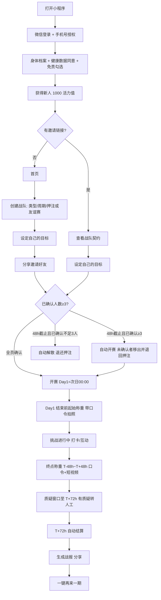

# FitSquad 瘦身战队 · MVP 产品需求文档（PRD v0.4）

> 版本：v0.4 ｜ 日期：2026-10-19 ｜ 主体：个体工商户 ｜ 平台：微信小程序 ｜ 变更见第 11 节

## 1. 产品概述

**一句话定位**：熟人 / 同事（公司、部门、好友、家庭）3 人起组队较劲，立下减重契约、押上赚来的活力值，比谁更能坚持。全员达成拿系统大奖，部分达成也有奖池分成。

| 人群 | 特征 | 核心诉求 |
|---|---|---|
| 同事 / 公司（部门、工位邻居） | 25–40 岁久坐职场人，BMI ≥ 24，一个人坚持不下去 | 同事之间较劲、有人监督、每天有话题；也是通向企业版（2.1）的核心场景 |
| 好友 / 饭搭子 | 同学、球友、饭搭子；含体重正常、想控体重养成运动习惯的人 | 好胜心、社交乐趣、习惯养成（V1.1 维持挑战） |
| 家庭 / 亲友 | 夫妻、兄弟姐妹、闺蜜 | 一起做件事，有话题（可先玩 0 押注友谊赛） |

**MVP 唯一核心假设**：熟人 / 同事组队能否带来高留存 + 自发裂变。MVP 不验证电商、充值、工具类功能。

**MVP 验证目标**（3–5 支队、15–25 人跑一期）：每队自发带来新用户 ≥ 1 人（裂变系数 K，**自发裂变是第一判据**）；30 天打卡留存 > 50%；达成率 > 40%；愿意参加第二期 > 60%。

## 2. 范围

**V1.0 包含**：微信登录 + 手机号绑定；身体档案（含健康数据单独同意、免责勾选）；积分账户与流水（活力值）；创建 / 加入战队（3–10 人，周期队伍自选，个人目标，押注或 0 押注友谊赛）；契约确认与 48 小时自动开赛；称重打卡（口令照片 / 终点短视频）+ 微信运动步数 + 生活打卡；队内动态、表情回应（含调侃表情）、催一下（分享卡片）、线下趣味惩罚（选填）；终点互审 + 人工审核；自动结算；队内排行、全站战队榜、周称号、超越提醒；分享海报；健康小知识；简易后台。

| 暂不包含 | 版本 | 原因 |
|---|---|---|
| 积分商城（虚拟装扮 / 运动好物 / 实物发货 / 公益） | 以后再说（MVP 不做） | 先验证熟人社交留存与裂变，不做会稀释焦点的电商 / 工具模块；未来若上线，作为活力值消耗出口 |
| 充值积分（花钱买积分） | 以后再说（MVP 不做） | 先验证熟人社交留存与裂变，不做会稀释焦点的电商 / 工具模块；且有对赌风险 |
| 维持挑战（减重挑战结束后 30 天体重保持在 ±1kg 内） | V1.1 | 防反弹，也适合体重正常的健康管理人群 |
| 体脂 / 腰围类目标 | V2.0 | 测量标准和防作弊方案待定 |
| 公司榜 / 企业版 | 第二阶段（变现主线，见 2.1） | 先用 MVP 验证同事组队留存与裂变，再拿去给 HR 卖 |
| 智能秤对接 | V2.0 | 需要硬件合作 |
| 抖音 / 支付宝小程序 | V2.0 | 先跑通微信 |

**红线（永不做）**：积分提现、转让、兑换现金；充值积分参与押注或进入奖池；任何"花钱下注、赢了拿现金或实物"的变种；医疗、治疗、药物减肥相关表述和商品。

### 2.1 第二阶段：企业版（「先2后1」的 1）
MVP（先2）跑通熟人 / 同事组队较劲之后，企业版是第一条变现主线，提前到第二阶段，不再放在 V2.0。

- **功能**：HR 采购开通；公司榜；部门 PK；HR 数据看板（只看参与率 / 打卡率 / 平均减重 %，不看个人 kg）；定制奖品（企业出资，线下发放）；按人头年费。
- **MVP 已埋的桥梁**：战队类型"公司"+ 公司名（T-13）、同事组队场景、战队榜。
- **启动条件**：MVP 核心假设成立（第 1 节指标达标），且出现企业线索。

## 3. 核心流程



## 4. 功能需求

### 4.1 用户
| ID | 需求 | 说明 |
|---|---|---|
| U-01 | 微信登录 | `wx.login` 拿 openid，首次进入自动建档 |
| U-02 | 手机号绑定 | 手机号快速验证组件（按次收费）；手机号唯一，一号一账号 |
| U-03 | 身体档案 | 身高 cm、体重 kg（1 位小数）、性别、出生年份；自动算 BMI。体重、身高、照片属于健康生理类敏感个人信息，提交前须单独勾选"我同意 FitSquad 处理我的健康数据用于挑战结算"（附《隐私政策》链接），不勾选不能提交 |
| U-04 | 健康准入 | BMI < 18.5 不能设减重目标；未满 18 岁不能参加押注挑战；参加押注挑战前须勾选免责：孕期 / 哺乳期、有进食障碍史、有基础疾病者不建议参加押注挑战 |
| U-05 | 个人主页 | 累计减重、参加 / 达成次数、徽章墙 |
| U-06 | 隐私 | 具体体重（kg）默认仅本人可见；队友看到减重百分比和目标百分比；本人可在隐私设置中开启"向队友显示具体体重"；对外（排行榜、海报、邀请页）只显示百分比 |
| U-07 | 注销账号 | 进行中的挑战视同中途退出（见 4.5） |

> 微信不开放好友列表，"好友"= 邀请关系 + 曾同队的人。

### 4.2 积分
V1.0 只有一种积分：活力值。

| 类型 | 来源 | 可押注 | 用途 | 说明 |
|---|---|---|---|---|
| 活力值（赚来的积分） | 新人 1000、打卡、步数、阅读、邀请、结算所得 | ✓ | 仅用于押注与荣誉体系（徽章 / 称号，纯虚拟） | V1.0 唯一积分类型；冻结中（押注中）的部分不能再次押注 |

| ID | 需求 | 说明 |
|---|---|---|
| P-01 | 账户 | 活力值：可用、冻结（押注中）、累计获得 |
| P-02 | 新人奖励 | 注册并完善档案 +1000 活力值 |
| P-03 | 流水 | 每笔变动记账（注明积分类型），不可删改 |
| P-04 | 通用规则 | 所有积分不可提现、不可转让 |
| P-05 | 有效期 | 12 个月滚动：每笔积分自获得之日起 12 个月后到期 |
| P-06 | 活力值用途 | MVP 只用于押注与结算内流转 + 徽章 / 称号纯虚拟荣誉；不设商城、不设实物出口；积分负债口径见解决方案第 7 节 |
| P-07 | 不重复计 | 每日打卡类积分每人每天只算一次，不按战队重复；同一用户在重叠时段参加 2 支战队时，按全额 R 较低的那支战队，其系统奖励部分（R 或 0.5×R）统一按 50% 发放；两支 R 相同时，后开赛的那支按 50% 发放（同时开赛则后创建的那支）；另一支全额发放；全员加成和奖池分成不受影响 |

| 获取途径（均为活力值） | 积分 | 限制 |
|---|---|---|
| 称重打卡 | +5 | 每天 1 次 |
| 步数 ≥ 8000 | +5 | 每天 1 次 |
| 阅读每日健康知识 | +1 | 每天 1 次 |
| 连续 7 个有效打卡日 | +30 | 每周 1 次 |
| 邀请新人 | +200 | 被邀请人完成首期挑战且打卡率 ≥ 50% 后发放；每月最多 10 人 |
| 挑战结算 | 见 4.5 | — |

| 消耗途径 | 积分 | 限制 |
|---|---|---|
| 押注 | −S（冻结，结算时释放） | 只能用可用活力值 |

### 4.3 战队
| ID | 需求 | 说明 |
|---|---|---|
| T-01 | 创建 | 队名、队徽（预设）、类型（公司 / 家庭 / 好友）、口号 |
| T-02 | 周期 | 队伍自选 14 / 21 / 30 / 60 天 |
| T-03 | 押注 | 全队统一，队长定：每人 100 / 200 / 500 / 1000 活力值，或 0 押注「友谊赛」 |
| T-04 | 友谊赛 | 0 押注：不进奖池、无系统奖励积分，只发徽章；用于降低亲友冷启动门槛 |
| T-05 | 人数 | 3–10 人 |
| T-06 | 个人目标 | 每人自定减重 kg，按 4.4 校验；开赛前可修改，修改后只需其他成员对"该成员的目标"重新确认；开赛后锁定 |
| T-07 | 邀请 | 小程序卡片 / 海报二维码，打开即见契约 |
| T-08 | 契约确认 | 成员确认周期、押注、每人目标、结算规则；已确认 ≥ 3 人且全员确认即开赛 |
| T-09 | 48 小时截止 | 建队后 48 小时截止时：已确认 ≥ 3 人即自动开赛，未确认成员自动移出并退回押注；已确认 < 3 人则自动解散，押注全部退回 |
| T-10 | 移出成员 | 队长可随时移出未确认成员，押注退回 |
| T-11 | 开赛时间 | Day 1 = 开赛次日 00:00（北京时间）；起始称重须在 Day 1 结束前完成，否则视为未开赛，移出并退回押注 |
| T-12 | 开赛后变动 | 开赛后不能新加入成员；有人退出导致少于 3 人时挑战照常继续；队长退出时自动转给加入最早的成员 |
| T-13 | 公司名 | 类型为公司时可填（第二阶段企业版用于公司榜 / 部门 PK） |
| T-14 | 并行 | 每人最多同时参加 2 支战队；重叠时段 R 较低那支战队的系统奖励部分按 50% 发放（见 P-07），打卡积分不重复 |
| T-15 | 再来一期 | 一键复制配置重新确认 |
| T-16 | 线下趣味惩罚（选填） | 建队第 2 步由队长选一项：请全队喝无糖茶 / 朋友圈发认输海报 / 下期当监工（负责每天催打卡）/ 不设置；写进契约，结算失败页提醒"愿赌服输"。纯线下自觉执行，平台不记录是否执行、不涉及任何积分，也不影响结算 |

### 4.4 健康目标上下限（系统强制）
```
周数 = 天数 / 7
目标下限(kg) = max( 0.5 , 周数 × 0.25 )
目标上限(kg) = min( 周数 × 1.0 , 初始体重 × 8% , 初始体重 − 20 × 身高(m)² )
（上限结果四舍五入保留 1 位小数；下限按各周期固定值展示：0.5 / 0.75 / 1.1 / 2.1；上限最后一项保证结束时计划 BMI 不低于 20）
```
| 周期 | 下限 | 上限：70kg / 175cm | 上限：90kg / 175cm | 上限：55kg / 160cm |
|---|---|---|---|---|
| 14 天 | 0.5 | 2.0 | 2.0 | 2.0 |
| 21 天 | 0.75 | 3.0 | 3.0 | 3.0 |
| 30 天 | 1.1 | 4.3 | 4.3 | 3.8（BMI 20 限制） |
| 60 天 | 2.1 | 5.6 | 7.2 | 3.8（BMI 20 限制） |

超上限不能提交，提示"健康减重建议每周不超过 1kg"；低于下限不能提交。上限低于下限时，该周期不能设减重目标（可换更短周期，或参加打卡）。页面常驻免责：本产品不提供医疗建议，有基础疾病请先咨询医生。

### 4.5 结算规则
- S = 每人押注；R = 系统奖励基数：14 天 100 ｜ 21 天 150 ｜ 30 天 200 ｜ 60 天 400
- 达成 = 终点体重 ≤ 起始体重 − 目标，且终点称重审核通过；起始体重定义见 C-02
- 打卡率 = 有效打卡日 / 挑战天数（有效打卡日定义见 C-07，每周上限见 C-04）

| 情况 | 达成者 | 失败者 |
|---|---|---|
| ① 全员达成 | 退回 S + 系统奖励 R + 全员加成 0.5×S + "铁血战队"徽章 | — |
| ② 部分达成 | 退回 S + 奖池分成 min(奖池 ÷ 达成人数, 0.5×S) + 系统奖励 0.5×R | 打卡率 ≥ 80%：返还 0.3×S（坚持奖），其余进奖池；否则全部进奖池 |
| ③ 全员失败 | — | 打卡率 ≥ 80%：返还 0.3×S，其余系统回收 |

- 奖池分成向下取整；奖池超出上限的部分和取整余数由系统回收（积分回收，不归任何人）。平台不抽成。
- 新用户（注册 < 14 天或首次挑战）失败时，押注不进奖池，由系统回收（坚持奖照常）。
- 友谊赛（S = 0）：不进奖池、无系统奖励积分，只发徽章。

**不变式**：任何情况下，达成者在全员达成时拿到的积分都严格多于部分达成时。单队结算差额 ≥ 0.5×R；重叠战队按 P-07 五折时差额 ≥ 0.25×R；两种情况都严格多于。
友谊赛（0 押注）没有积分结算，不适用该不变式。
推导（单队）：① − ② = (R + 0.5×S) − (min(奖池 ÷ 达成人数, 0.5×S) + 0.5×R) ≥ 0.5×R > 0。达成者不会因队友失败而多拿。
推导（重叠战队五折）：① − ② = (0.5×R + 0.5×S) − (min(…, 0.5×S) + 0.25×R) ≥ 0.25×R > 0。

**例子**：5 人、S = 200、30 天（R = 200）；3 人达成，Lily 失败（打卡率 85%），大刘失败（打卡率 40%）。

| 成员 | 计算 | 到账 |
|---|---|---|
| Lily（失败，85%） | 坚持奖 0.3 × 200 = 60；进池 140 | 60 |
| 大刘（失败，40%） | 进池 200 | 0 |
| 奖池 | 140 + 200 = 340；340 ÷ 3 = 113 超上限 0.5×S = 100 | 每人分 100，系统回收 40 |
| 每位达成者 | 退回 200 + 奖池分成 100 + 系统奖励 0.5 × 200 = 100 | **400** |
| 对照：全员达成 | 退回 200 + 系统奖励 200 + 全员加成 100 | **500** + 铁血战队徽章 |

**结算时间线**（T = 挑战最后一天 24:00，北京时间）：

| 时间 | 事件 |
|---|---|
| T−48h ~ T+48h | 终点称重窗口（C-03） |
| 至 T+72h | 质疑窗口，T+72h 关闭（4.7） |
| T+72h | 自动结算；若有成员在人工审核中，全队一起延后结算，审核须在 72 小时内完成（最晚 T+144h），超时未审视为审核通过 |

**特殊情况**：中途退出（含注销账号）→ 视同失败、无坚持奖，押注进奖池（新用户由系统回收）；T+48h 前未完成终点称重 → 失败；终点作弊 → 失败并扣信用分。

### 4.6 打卡
| ID | 需求 | 说明 |
|---|---|---|
| C-01 | 称重标准 | 晨起、空腹、如厕后、轻衣、同一台秤；打卡页常驻提示 |
| C-02 | 起始称重 | 秤读数 + 当日 4 位口令（写纸上入镜）同框拍照，只能现场拍；Day 1 结束前完成。起始体重 = min(起始带口令称重, 近 7 天内档案或打卡体重)（有数据时） |
| C-03 | 终点称重 | 窗口 T−48h ~ T+48h；带口令拍照 + 3–5 秒上秤短视频（相机现场录制，不能选相册） |
| C-04 | 日常称重 | 拍照打卡（秤读数入镜即可，不需要口令），每天最多 1 次；周的划分：从 Day 1 起每 7 天为一周，最后不足 7 天的尾周至少称重 1 次；完整周要求至少 2 次，当周不足 2 次则该周有效打卡日最多计 5 天（影响打卡率和坚持奖，不直接影响达成判定）；可对队友隐藏具体体重 |
| C-05 | 步数 | `wx.getWeRunData` 自动同步 |
| C-06 | 生活打卡 | 饮食 / 运动照片 + 一句话 |
| C-07 | 有效打卡日 | 当天完成以下任一项：称重 / 步数 ≥ 6000 / 饮食或运动打卡；打卡率 = 有效打卡日 / 挑战天数（当周称重不足 2 次时该周最多计 5 天，见 C-04） |
| C-08 | 补卡 | 不支持 |
| C-09 | 内容安全 | 图文过微信内容安全接口 |
| C-10 | 提醒 | 微信订阅消息基本是一次性授权（每次授权只能发一条），不做"每日固定提醒"承诺：每次打卡完成后引导"订阅明天的提醒"；开赛时引导订阅结算通知；"催一下"走分享卡片（4.7），不消耗订阅额度 |
| C-11 | 照片 / 视频保留 | 打卡照片和视频在结算后 30 天删除，保留图片哈希用于风控 |

### 4.7 队内互动
- 队内动态：打卡、生活打卡、里程碑（"小王已减 3%"，默认显示百分比）
- 表情回应：加油 💪 / 太强了 🔥 / 别偷吃 🍰 / 就这？ / 我先瘦为敬 / 你礼貌吗（后 3 个为调侃表情，文字气泡样式，同样计入"气氛组组长"统计）
- 催一下：生成分享卡片发到微信群 / 私聊（如"@大刘 该上秤了 ⚖️"），不消耗订阅消息额度；每人每天最多 3 次；被催次数计入"嘴硬王者"统计（见 R-06）
- 线下趣味惩罚：建队时选填（T-16），契约页和结算失败页展示，不涉及积分
- 中期加码：过半时推队内小任务（"全队今天都满 1 万步，每人 +20"）
- 终点互审：队友可"认可 / 质疑"终点称重。质疑必须选择理由（读数看不清 / 口令不符 / 疑似非本人 / 疑似换秤 / 视频疑似非现场 / 其他）；质疑不会直接判失败，只会把该成员转人工审核；质疑被驳回累计 2 次，扣质疑人信用分 10。质疑窗口 T+72h 关闭

### 4.8 排行榜
| ID | 榜单 | 规则 |
|---|---|---|
| R-01 | 队内排行 | 按减重百分比排序；自己看 kg + %；队友之间显示 % 和目标 %（kg 仅本人可见，是否向队友显示由本人设置） |
| R-02 | 全站战队榜 | 本月结算的战队，按全队平均减重百分比排序，达成率作为次序；只显示百分比 |
| R-03 | 个人总榜 | 只显示百分比 / 积分 |
| R-04 | 好友榜 | 邀请关系 + 曾同队的人 |
| R-05 | 公司榜 | 第二阶段（企业版，见 2.1） |
| R-06 | 周称号 | 每周（从 Day 1 起每 7 天）结束后在队内自动颁发，只按行为 / 数据评，不看体型：卷王（本周减重 % 第一）、打卡钉子户（本周 7/7 有效打卡）、步数刺客（本周步数第一）、气氛组组长（本周点赞 / 回应最多）、嘴硬王者（本周被催次数最多）、摸鱼选手（本周有效打卡最少，温和调侃）。按上述顺序颁发，每人每周最多 1 个称号，已占用时顺延给下一名（打卡钉子户可多人同时获得）；摸鱼选手不顺延，并列最少或最少者已有称号时本周空缺。展示在战队主页和队内排行；排行榜（好友榜 / 个人榜）对非队友只显示 4 个正向称号（卷王 / 打卡钉子户 / 步数刺客 / 气氛组组长），嘴硬王者、摸鱼选手只队内可见。友谊赛同样颁发；仅 1 人有数据时不颁发 |
| R-07 | 超越提醒 | 好友 / 队友在减重 % 上反超你时（双方都有进行中挑战，比较各自本期减重 %；在打卡写入后由云函数判定），下次打开首页和战队主页顶部出现横幅（文案示例：「⚠️ 你被 Lily 反超了 0.3%！她让我转告你：'就这？'」），按钮「不服，去打卡」→ 打卡页、「发给她：等着」→ 生成分享卡片发微信。只做小程序内横幅 + 分享卡片，不发订阅消息（不占 C-10 额度）；每人每天最多出现 1 次，取差值最大的一条；只比较百分比，不出现 kg |

### 4.9 分享海报
周战报（每周一生成，含本周称号）；结算战报（达成版 / 失败自嘲版，设了线下趣味惩罚的队可直接生成"认输海报"）；邀请海报（小程序码 + 契约摘要）；超越分享卡（R-07）。默认只显示百分比，文案按 4.13。

### 4.10 健康知识
分类：饮食、运动、作息、误区；首页每日一条；科普口吻、不出现医疗表述；内容官 Agent 产出，人工审核发布。

### 4.11 运营后台
用户查询与封禁；战队查询与手动重算；终点称重人工审核（含质疑理由、短视频）；风控告警；文章管理；积分手动调整（必填原因、留日志）。

### 4.13 文案规范
产品语气：诙谐、搞怪、互相调侃，激发好胜心——像同事之间打赌，通过好友排名和组队一起把体重和健康管住。所有页面、海报、分享卡、提醒、Agent 产出都遵守以下红线：

1. **只调侃行为**：偷吃、摸鱼、熬夜、赖床、嘴硬、不打卡。
2. **绝不调侃身体**：不拿体型、体重数字、长相、性别、年龄、健康状况开玩笑；文案里不出现具体 kg。
3. **失败不羞辱**：失败文案用自嘲 + 约定复仇（如"这期我先给队友当垫脚石，下期见"），不点名嘲笑失败者。
4. **不鼓励极端节食**：不出现"宁可挨饿也要瘦""不吃晚饭"这类说法，不鼓励断食、催吐、脱水、过量运动。
5. **调侃 = 友好较劲，不是羞辱**：被调侃的人看了会笑、想回嘴，而不是难受；可以用 emoji。

文案语气库和各场景示例见 `03-Mockup提示词.md` 第 6 节；运营文案按 `ops/agents/content.md` 执行。

## 5. 风控规则
| 规则 | 触发 | 处理 |
|---|---|---|
| 体重异常 | 单日降 > 1.5kg 或单周降 > 2.5kg | 标记，要求补拍口令照 |
| 照片重复 | 图片哈希与历史相同 / 相似 | 打卡无效 |
| 起始体重偏差 | 起始称重高于近 7 天档案或打卡体重 | 起始体重取较低值（C-02） |
| 终点称重不合规 | 缺口令、缺短视频、不在 T−48h ~ T+48h 窗口 | 判未完成终点称重 |
| 终点被质疑 | 任一队友带理由质疑 | 转人工审核，不直接判失败；全队延后结算（≤ 72 小时，超时视为通过） |
| 恶意质疑 | 质疑被驳回累计 2 次 | 质疑人信用分 −10 |
| 多账号 | 同设备 / 异常聚集 | 人工复核 |
| 新用户失败 | 注册 < 14 天或首次挑战的账号失败 | 押注不进奖池，系统回收（防止小号送分给大号） |
| 刷邀请 | 被邀请人未完成首期挑战，或打卡率 < 50% | 不发邀请奖励 +200 |
| 重复计分 | 重叠时段 2 支战队 | R 较低那支战队的系统奖励部分按 50% 发放；打卡积分每天只算一次 |
| 信用分 | 初始 100，作弊一次 −30，恶意质疑 −10 | < 60 禁止押注挑战 |

## 6. 页面清单
| # | 页面 | 主要元素 |
|---|---|---|
| 1 | 启动 / 登录 | 品牌、Slogan、微信登录、手机号授权 |
| 2 | 新手引导 | 玩法介绍 → 身体档案（健康数据单独同意、免责勾选）→ 领 1000 活力值 |
| 3 | 首页 | 超越提醒横幅、进行中战队、今日打卡、每日知识、榜单入口、创建战队 |
| 4 | 创建战队（3 步） | 基本信息 → 规则（周期、押注 / 友谊赛、线下趣味惩罚选填）→ 我的目标 |
| 5 | 契约详情 / 邀请落地页 | 成员、每人目标（%）、押注、规则、线下趣味惩罚、48 小时截止说明、我也加入 |
| 6 | 设定个人目标 | 体重、目标滑块、健康上下限、预计每周减重 |
| 7 | 战队主页 | 倒计时、全队进度、本周称号、超越提醒横幅、队内排行（% / 目标 %）、动态（含调侃表情）、催一下（分享卡） |
| 8 | 打卡 | 称重标准、相机 + 口令、终点短视频、体重、步数、生活打卡、订阅明天提醒 |
| 9 | 结算结果 | 达成 / 失败、积分明细、徽章、线下趣味惩罚提醒（失败页）、分享、再来一期 |
| 10 | 排行榜 | 全站战队 / 个人 / 好友，周称号标签 |
| 11 | 积分中心 | 活力值余额、冻结、流水、有效期、赚积分任务 |
| 12 | 健康知识 | 分类、列表、详情 |
| 13 | 我的 | 数据、徽章、历史战队、档案、隐私设置、企业认证（第二阶段）、协议 |
| 14 | 分享海报 | 周战报 / 结算 / 邀请；超越分享卡 |

## 7. 数据模型（云开发）
```text
users          openid, phone, nickname, avatar, gender, birth_year, height_cm,
               weight_kg, bmi, credit_score, invited_by, health_consent_at,
               disclaimer_at, show_kg_to_team, created_at, deleted_at
point_accounts user_id, vitality_available, vitality_frozen, vitality_total_earned
point_ledger   user_id, point_type(vitality，预留扩展), type, amount(+/-), balance_after,
               expire_at, ref_team_id, remark, created_at
teams          name, icon, type, company_name, captain_id, period_days, stake(0=友谊赛),
               max_size, status(forming|active|settling|settled|dissolved),
               start_code, end_code, form_deadline, start_at, day1_at, end_at,
               offline_penalty(tea|lose_poster|supervisor|none)
team_members   team_id, user_id, goal_kg, confirmed_at, joined_at, start_weight,
               start_photo, end_weight, end_photo, end_video, valid_days, status,
               review_status, settle_amount
checkins       team_id, user_id, date, type(weigh|life|steps), weight_kg, photo_url,
               photo_hash, code_used, steps, text, hidden, review_status
interactions   team_id, from_user, to_user, type(like|nudge_card|doubt), reaction
               (cheer|fire|cake|jiuzhe|shou_wei_jing|limao), doubt_reason,
               doubt_result, target_checkin_id
weekly_titles  team_id, week_no, user_id, title(juanwang|dingzihu|bushu|qifenzu|zuiying|moyu),
               metric_value, created_at
notices        user_id, type(overtake), from_user, delta_pct, shown_at, created_at
articles       title, category, cover, content, status, publish_at
risk_flags     user_id, team_id, rule, detail, status, handled_by
```
积分变动只能在云函数里用事务完成（同时改账户 + 写流水）；前端不能写积分、战队状态和结算字段。押注只能从活力值冻结。

## 8. 合规清单
- [ ] 个体工商户执照 → 小程序认证 → ICP 备案
- [ ] 类目选"工具 / 健康管理"或"体育 / 运动健身"（以后台可选为准）
- [ ] 用户协议 + 隐私政策（说明收集身高、体重、照片、视频、步数及用途、保存期限）
- [ ] 健康数据单独同意：身体档案页单独勾选"我同意 FitSquad 处理我的健康数据用于挑战结算"，附隐私政策链接
- [ ] 打卡照片 / 视频结算后 30 天删除，仅保留图片哈希用于风控
- [ ] 免责勾选：孕期 / 哺乳期、进食障碍史、有基础疾病者不建议参加押注挑战
- [ ] 积分规则公示：活力值用途（仅押注与荣誉）、不可提现、不可转让、不出售积分、12 个月有效期
- [ ] 内容安全接口；未成年人限制
- [ ] 文案自查：全站文案、海报、分享卡符合 4.13 文案红线（不调侃身体、不鼓励节食）

## 9. 核心指标
裂变系数 K（核心假设第一判据）、成团率、D7 / D14 / D30 打卡留存、达成率、全员达成率、复参率（结算后 7 天内再开一期）、分享率。

## 10. 里程碑
| 周 | 交付 |
|---|---|
| W1 | 办个体户、注册小程序、开始备案；出 Mockup |
| W2–W3 | 登录、档案、积分、战队创建 / 邀请 / 确认 |
| W4 | 打卡、步数、动态、催一下 |
| W5 | 结算、排行（含周称号、超越提醒）、海报、知识、后台 |
| W6 | 内测 + 提审 |
| W7–W10 | 种子期 3–5 支队跑 30 天 |
| W11 | 复盘核心假设（留存 + 裂变），决定 V1.1 与企业版试点 |

## 11. 版本记录

| 版本 | 日期 | 主要变更 |
|---|---|---|
| v0.1 | 2026-10-17 | 初版：MVP 范围、积分 / 战队 / 打卡 / 结算 / 排行 / 海报 / 健康知识、风控、页面清单、数据模型、合规、里程碑 |
| v0.2 | 2026-10-17 | 逻辑评审修复：结算激励倒挂、充值积分对赌风险、刷目标、称重作弊、互审利益冲突、组队卡死、订阅消息限制；打卡减负、排行公平、隐私合规、新用户风控、友谊赛、维持挑战规划（明细见下） |
| v0.3 | 2026-10-17 | 积分商城提前到 V1.0（4.12）；新增文案规范（4.13）与诙谐调侃互动：周称号、超越提醒、调侃表情、线下趣味惩罚（明细见文末） |
| v0.4 | 2026-10-19 | 定位收窄为熟人 / 同事组队较劲游戏；砍掉积分商城与充值积分（移入"以后再说"）；企业版提前为第二阶段变现主线（2.1）；明确 MVP 唯一核心假设（熟人 / 同事组队的留存与自发裂变）（明细见文末） |

### v0.2 变更明细
- 结算：全员达成加 0.5×S 全员加成；部分达成奖池分成封顶 0.5×S，超出部分系统回收；写明不变式（全员达成严格多于部分达成；单队差额 ≥ 0.5×R，重叠战队五折时差额 ≥ 0.25×R）；示例改为部分达成 400 / 全员达成 500。
- 积分：拆为活力值（可押注、可兑换）和充值积分（V1.1，只能兑换，不能押注、不能进奖池）；全部不可提现、不可转让；12 个月滚动有效期；商城按 1 积分 ≈ 0.01 元成本定价。
- 目标：下限改为 max(0.5kg, 周数 × 0.25kg)；上限增加"结束时计划 BMI ≥ 20"；新增 0 押注友谊赛；重叠战队中 R 较低那支的系统奖励部分按 50% 发放、打卡积分不重复。
- 称重：统一称重标准；起始体重取起始称重与近 7 天记录的较小值；终点称重窗口 T−48h ~ T+48h，需口令 + 3–5 秒现场短视频。
- 互审：质疑必须选理由，只转人工不直接判失败；被驳回 2 次扣信用分 10；结算时间线 T+48h / T+72h。
- 组队：48 小时截止时已确认 ≥ 3 人自动开赛；队长可移出未确认成员；改目标只需对该目标重新确认；开赛后不加人、少于 3 人照常、队长退出自动转交、注销视同退出；Day 1 = 开赛次日 00:00，Day 1 内须完成起始称重。
- 提醒：订阅消息改为"打卡后订阅明天的提醒"、开赛时订阅结算通知；催一下改为分享卡片。
- 打卡：有效打卡日 = 称重 / 步数 ≥ 6000 / 饮食或运动打卡任一项；称重每周至少 2 次；打卡率按有效打卡日计算。
- 排行：全站战队榜按全队平均减重百分比排序、达成率次之；kg 默认仅本人可见。
- 合规：健康数据单独同意；照片 / 视频结算后 30 天删除；新增免责勾选。
- 风控：新用户失败押注系统回收；邀请奖励在被邀请人完成首期且打卡率 ≥ 50% 后发放。
- 规划：V1.1 增加维持挑战；体脂 / 腰围目标放 V2.0。

**已定口径（v0.2 补充）**

1. 重叠战队系统奖励：不再"只发一次"，改为 R 较低的那支战队系统奖励部分按 50% 发放（R 相同时后开赛的那支五折，同时开赛则后创建的那支），不变式仍成立（差额 ≥ 0.25×R）。
2. 人工审核：有成员在审时全队一起延后结算，审核 ≤ 72 小时，超时视为通过；避免先结算后补算。
3. 每周称重不足 2 次：该周有效打卡日最多计 5 天，影响打卡率和坚持奖，不直接判失败。

### v0.3 变更明细
- 积分商城：从 V1.1 提前到 V1.0（4.12），作为活力值主要消耗出口；只用可用活力值兑换（冻结中不可用，充值积分 V1.1 上线后也可用）；分类 全部 / 虚拟装扮 / 运动好物 / 公益（敬请期待）；虚拟装扮 100–500、运动好物 1,000–9,900（体脂秤每月限量 5 台）；实物需收货地址、7 天内人工发货、每人每月最多 2 件、注册满 30 天且完成过 ≥ 1 期挑战；兑换后不退不换、质量问题换货；流水类型 `redeem`。
- 商城红线：不卖补卡、免罚 / 免死金牌、改目标、额外称重机会等任何影响公平和结算的东西。
- 数据模型：新增 products / orders / addresses；teams 增加 offline_penalty；interactions 增加 reaction；新增 weekly_titles、notices。后台增加商品管理和发货队列；风控增加刷积分换实物、实物超量、商城卖公平三条。
- 文案规范（4.13）：只调侃行为、不调侃身体、失败不羞辱、不鼓励节食、调侃是友好较劲。
- 互动：表情回应新增「就这？」「我先瘦为敬」「你礼貌吗」；建队可选线下趣味惩罚（T-16，不涉及积分）；新增周称号（R-06）和超越提醒（R-07，只做小程序内横幅 + 分享卡片，不发订阅消息）。
- 页面：新增第 15 项积分商城（3 页）；首页、战队主页、排行、契约、结算失败、我的、积分中心按上述功能补充。

**已定口径（v0.3 补充）**

1. 周称号每人每周最多 1 个，按 R-06 顺序颁发、被占用时顺延；"嘴硬王者""摸鱼选手"只队内可见，摸鱼选手不顺延、并列时空缺。
2. 超越提醒每人每天最多 1 次，只比较减重 %。
3. 实物兑换另加：信用分 < 60 不能兑换；未发货可后台取消并退回积分（`redeem_refund`）；签收或发货 15 天后订单自动完成；实物定价含运费。

### v0.4 变更明细
- 定位：一句话定位收窄为熟人 / 同事（公司、部门、好友、家庭）组队较劲；人群表首行改为同事 / 公司（通向企业版的核心场景）；新增"MVP 唯一核心假设"（熟人 / 同事组队的留存 + 自发裂变），验证目标把自发裂变放在第一位。
- 范围：V1.0 删积分商城，后台不再含商品与发货；积分商城、充值积分移入"暂不包含"表，版本标"以后再说（MVP 不做）"；红线原文不动（"充值积分参与押注或进入奖池"仍约束未来）。
- 企业版：新增 2.1，提前为第二阶段变现主线（「先2后1」的 1）；T-13、R-05、范围表同步改为"第二阶段"。
- 积分（4.2）：只剩活力值一种，用途改为"仅用于押注与荣誉体系"；删充值积分行和"积分商城兑换"消耗途径；P-01 删充值积分余额；P-06 由"商城定价"改为"活力值用途"（MVP 无实物出口，ID 保留避免编号空洞），P-07 不变。
- 删除：4.11 后台的商品管理、订单发货队列；4.12 积分商城整节（4.13 不重编号）；第 5 节"刷积分换实物 / 实物超量 / 商城卖公平"三条风控，信用分处理去掉"禁止兑换实物"。
- 页面（第 6 节）：删第 15 项积分商城（3 页）；11 积分中心、13 我的去掉兑换、商城、充值、收货地址相关元素。
- 数据模型（第 7 节）：删 products / orders / addresses 三张表；point_accounts 删 recharge_available；point_ledger.point_type 收窄为 vitality（预留扩展）；删商城兑换事务与地址说明。
- 合规（第 8 节）：积分规则公示改为活力值用途；删商城规则公示与收货地址条目。
- 指标 / 里程碑：裂变系数 K 放第一位并标为第一判据；W5 去掉积分商城与商品发货，W11 改为复盘核心假设并决定 V1.1 与企业版试点。
- 不变：押注、冻结、奖池、结算（500 / 400 / 60）、系统回收、打卡积分、周称号、超越提醒、调侃表情、线下趣味惩罚、新人 1000、12 个月有效期全部保留。
