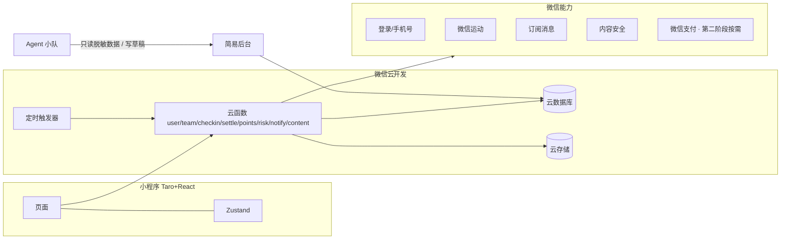
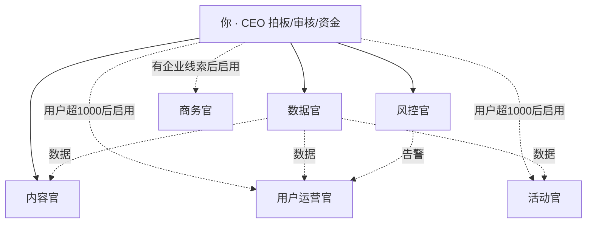

# FitSquad 瘦身战队 · 整体解决方案 v0.7

> 配套：[01-PRD-MVP.md](./01-PRD-MVP.md)（PRD v0.7）｜ [03-Mockup提示词.md](./03-Mockup提示词.md) ｜ [ops/README.md](../ops/README.md)

## 1. 方案总览
| 维度 | 决策 |
|---|---|
| 形态 | 微信小程序（V2.0 扩展抖音） |
| 主体 | 先用个体工商户 + 小程序认证 |
| 玩法 | 熟人 / 同事（公司、部门、好友、家庭）3–10 人组队 → 队伍自选 14/21/30/60 天 → 每人定目标 → 押活力值（或 0 押注友谊赛）→ 结算 |
| 核心假设 | MVP 只验证一件事：熟人 / 同事组队能否带来高留存 + 自发裂变 |
| 积分 | 只有活力值（赚来的），只用于押注与结算内流转 + 徽章 / 称号荣誉；不可提现、不可转让，12 个月滚动有效；MVP 不设充值积分 |
| 积分负债 | MVP 不设实物出口，负债天然可控：押注在队内流转不新增负债 + 12 个月有效期自然出账 + 系统回收；未来若上商城再作消耗出口 |
| 文案 | 诙谐搞怪、互相调侃、激发好胜心（周称号、超越提醒、调侃表情、线下趣味惩罚）；只调侃行为，不调侃身体（PRD 4.13） |
| 结算 | 全员达成：退回 + R + 0.5×S 加成；部分达成：奖池分成封顶 0.5×S + 0.5×R。全员达成永远严格多于部分达成（差额 ≥ 0.5×R），避免"盼队友失败" |
| 并行限制 | 每人同时只能参加 1 支战队，这期结束才能开下一支（规则更简单，无跨战队重复计分） |
| 技术 | Taro + React + TS ／ 微信云开发 |
| 运营 | 你（CEO）+ Agent 小队分阶段启用（种子期 3 个）；钱、对外内容、封号由人工把关 |

**为什么 MVP 不做充值积分和商城**：①充值后押注、赢走他人积分再换实物，就等于"花钱下注赢实物"，接近变相对赌；②商城、发货、库存是电商的活，会稀释"熟人较劲"这个验证焦点。所以 MVP 的押注、奖池只流转赚来的活力值，活力值只换荣誉。

## 2. 系统架构

| 层 | 选择 | 理由 |
|---|---|---|
| 前端 | Taro 4 + React + TS | 跨端，AI 写 React 最稳 |
| UI | NutUI-React / Taroify | 现成移动端组件 |
| 后端 | 云函数 Node.js | 免运维，自带 openid 鉴权 |
| 数据库 | 云数据库 | 支持事务，积分记账必须用 |
| 定时 | 定时触发器 | 提醒、到期结算、风控扫描 |
| 海报 | Canvas 2D | 前端生成 |

取舍：云开发和微信绑定较深，上抖音时后端要部分重写；MVP 先求快。

**安全要点**：数据库设为仅云函数可写；积分和结算只在云函数算，不信任前端数值；押注只能冻结活力值；照片 / 视频私有存储 + 临时链接，只有队友和审核人员能看，结算后 30 天删除（保留哈希）；后台加管理员白名单。

**订阅消息限制**：微信小程序订阅消息基本是一次性授权（每次授权只能发一条），"每日提醒"不可靠。做法：每次打卡完成后引导"订阅明天的提醒"；开赛时引导订阅结算通知；"催一下"生成分享卡片发到微信群 / 私聊，不消耗订阅额度。

## 3. 主体与资质
| 步骤 | 事项 | 耗时 | 费用（参考） |
|---|---|---|---|
| 1 | 线上办个体户执照（经营范围含"健康咨询服务（不含诊疗）""软件开发"） | 3–7 天 | ≈0 |
| 2 | 用个体户注册小程序 + 认证 | 1–5 天 | ≈300 元/年 |
| 3 | ICP 备案 | 1–3 周 | 0 |
| 4 | 开通云开发 | 当天 | 几十元/月起 |
| 5 | 第二阶段（企业版收费）按需申请微信支付商户号 / 对公收款 | 1–3 天 | 按费率 |
| 6 | 用户协议、隐私政策、积分规则 | 1 天 | Agent 起草，人工核对 |

> 费用和类目以办理时官方规则为准。

## 4. 增长方案
| 阶段 | 时间 | 目标 | 重点 |
|---|---|---|---|
| 种子期 | 第 1–3 月 | 50–200 人 | 同事 / 好友 3–5 支队跑通，验证留存 + 自发裂变 |
| 增长期 | 第 4–9 月 | 1k–10k 人 | 裂变 + 内容 + 节点活动 |
| 变现期 | 第 10 月起 | 10k+ | 企业版、赞助 |

**种子期**：优先拉同事 / 部门组队，至少 1–2 支公司队，为企业版积累案例；你当第 1 支队队长；请 2–3 个朋友各当队长拉自己的圈子（混进你不认识的人）；建种子群每周收反馈；首期全员达成的队送小礼品并做案例；全程拍成内容（《我拉了 4 个亲戚组队减肥 30 天》）。

MVP 唯一验证假设：熟人 / 同事组队的留存与自发裂变（看 K 和复参率）。

**内置裂变**：3 人起团；0 押注友谊赛降低亲友试玩门槛（首期默认友谊赛 · 21 天）；邀请奖励 +200（被邀请人完成首期且打卡率 ≥ 50% 后发放）；周战报 + 失败自嘲海报 + 每晚战况卡；一键再来一期 / 复仇局；战队 PK（V1.1，输的队发认输海报）。

**不留死路（v0.7）**：开赛后不能加人、每人同时只能 1 支队，原本意味着群里看到战报卡的人点进来什么都做不了——这是裂变漏斗最大的漏点。现在所有卡片落地页按战队状态分流：组队中 → 加入；已开赛 → 「围观」（只看 %、可发表情）+「报名下一期」，下期开组时自动收到邀请。配合「预约下一期」（最后 7 天预约、结算后 ≥3 人自动开组），围观者和老队员在同一个时间点汇入下一期。

**留存引擎（V1.0，成本几乎为 0）——核心差异化：记录工具和陪伴打卡别人都有，熟人关系 + 游戏化留存是 FitSquad 独有的**。减重本身反馈慢、反人性，单靠"我瘦了多少"做不出瘾；真正上瘾的是"我在这群人里排第几 + 有人在看我"。所以留存靠三件套（只做这三个，不堆功能，PRD 4.14）：
- **连胜 Streak**：连续打卡天数做成首页最大的主角数字（"连续 9 天 · 别断在今天"），断一天清零——这是第一留存杀器，让人每天非打开不可（同多邻国 / Snap）；
- **每天一条社交钩子**：被谁反超 / 谁在群里 @你，只给一条最扎心的 + 一个动作（回怼 / 去打卡），制造社交亏欠感；
- **盲盒式可变奖励**：打卡成功后开盲盒，结果每天不同（连胜 +1 / 反超某人 / 盲盒表情），像拆盲盒一样期待下一次（纯虚拟，不碰积分经济）。
段位 / 赛季 / 战队 PK 太费脑，留 V1.1。

**v0.7 补强（同样不碰积分经济）**：
- **免断卡**：连胜每满 7 天送 1 张、最多 2 张，断签那天自动顶上。断一天清零最容易让连了 20 天的人直接弃坑（多邻国的连胜冻结就是为此）；免断卡只保护连胜数字，不算打卡、不影响结算。
- **队伍连胜**：全队当天都打卡才 +1，一人缺就清零。个人连胜是"我别断"，队伍连胜是"别因为我断"——这才是熟人盯梢的产品灵魂。20:00 后没打卡的人亮红点，队友一键催。
- **每晚战况卡**：订阅消息靠不住，真正每天能触达的是战队所在的微信群。20:00 生成一张"谁打了谁还没"的卡，任一成员一键转进群。
- **两期之间不断档**：预约下一期 + 结算后自动开组；组队中 / 结算中也能续个人连胜。
- **第一次失败不流失**：首期默认友谊赛；失败页主按钮是"开复仇局"，原班人马一键再战。
- **凑不齐人也能先玩**：单人热身——没队伍的人先一个人打卡攒连胜、开盲盒（不押注、不进榜、不发打卡积分），第 3 天起首页提示"拉 2 个人，连胜带进战队"。冷启动从"必须先说服 2 个人"变成"先自己上瘾，再拉人"。

支撑这三件套的调侃素材照旧：周称号（卷王 / 打卡钉子户 / 步数刺客 / 气氛组组长 / 嘴硬王者 / 摸鱼选手，每周队内自动颁发，只看行为数据）、调侃表情「就这？」「我先瘦为敬」「你礼貌吗」、线下趣味惩罚（建队选填，不涉及积分）；文案红线只调侃行为、不碰身体、失败自嘲 + 约复仇、不鼓励极端节食（PRD 4.13）。

**上手门槛（容易上手，不动脑）**：登录后先看"热闹现场"（别人的战队动态 + 排行 + 互相嘲）再引导组队；身体档案延后到要打卡 / 设目标 / 加入押注战队时才填；每屏一个主按钮；打卡打开即相机。目标是从打开到"爽第一次" 30 秒内、点 3 下。视觉走深色 Tesla 式极简 + 潮玩点睛（设计基准见 `docs/.agents/tasks/v06-design-baseline.md`）。

**内容渠道**：小红书每周 3–5 篇真实记录 / 食谱 / 办公室微运动；抖音 / 视频号每周 2–3 条称重瞬间、惩罚现场；公众号每周 1 篇；社群每日。

**节点**：2–3 月节后脱脂 ｜ 4–5 月夏天前瘦一圈 ｜ 9 月秋季重启 ｜ 11–12 月年会前上镜。

## 5. 盈利路线
| 优先级 | 模式 | 时间 | 说明 |
|---|---|---|---|
| 1 | 企业版 | 第二阶段（MVP 核心假设成立后启动，增长期试点、变现期规模化） | 「先2后1」的 1：HR 采购、公司榜、部门 PK、数据看板、定制奖品、按人头年费（PRD 2.1） |
| 2 | 品牌赞助赛 | V1.1+ | 运动 / 健康品牌冠名出奖品 |
| 3 | 会员 | V2.0 | 高级报告、AI 饮食建议、更多模板 |

积分商城：以后再说；若上线，定位是活力值消耗出口 / 成本中心，不作盈利项。

**企业版为什么是真主线**：海外的企业健康挑战（VantageFit、Wellable、MoveSpring、GoJoe 这类）已经是成熟的 B2B 付费赛道，卖的就是实时追踪 + 团队排行榜 + HR 看板 + 积分奖励；国内这块还基本空白。FitSquad 的同事组队正好是它的 C 端入口，所以企业版是能真正收上钱的主线。

> 平台不从奖池抽成，避免被认定为组织下注获利。

**产品规划**：V1.1 上线「维持挑战」——减重挑战结束后 30 天体重保持在 ±1kg 内，防反弹，也适合体重正常的健康管理人群；体脂 / 腰围类目标留到 V2.0。

## 6. Agent 运营小队

**分阶段启用**：

| 阶段 | 启用 Agent | 触发条件 |
|---|---|---|
| 种子期 | 内容官、数据官、风控官（3 个） | 上线即用 |
| 增长期 | + 活动官、用户运营官 | 注册用户 > 1000 |
| 企业期 | + 商务官 | 出现企业线索（第二阶段企业版主线） |

种子期活动、触达、组队撮合由你本人在种子群里直接做，不需要单独的 Agent。

| Agent | 输入 | 输出 | 频率 | 人工把关 |
|---|---|---|---|---|
| 内容官 | 热点、画像 | 站外增长内容：小红书 / 抖音 / 视频号文案、海报文案（MVP 站内不做健康知识文章） | 每日 | 发布前审核 |
| 活动官 | 节点日历、活动数据 | 活动方案、节点挑战、积分建议 | 每周 | 发积分前确认 |
| 用户运营官 | 打卡数据、流失名单、反馈 | 提醒文案、客服草稿、召回方案 | 每日 | 批量推送前确认 |
| 风控官 | 打卡、照片哈希、邀请关系 | 告警清单、处理建议 | 每日 | 封号扣分由人定 |
| 数据官 | 只读导出 | 日报、周报、漏斗、实验建议 | 日 / 周 | 无 |
| 商务官 | 公司战队、行业资料 | 企业线索、合作方案、赞助提案 | 每周 | 外发前审核 |

提示词文件已放在 `ops/agents/`，日常流程见 `ops/README.md`。

**落地节奏**：种子期手动触发 3 个 Agent，每天约 30 分钟（导出 → 跑 Agent → 审核 → 发布）；增长期用定时任务 / Kiro Hook 自动产出草稿，你只看待审核清单；变现期数据官周报自动驱动选题，客服自动回复，高风险转人工。

**安全边界**：Agent 只读脱敏数据（不碰手机号、照片原图）；不能直接改数据库，积分、封号、发奖只出建议；对外内容一律人工审核。

## 7. 成本（种子期每月，参考）
认证约 25 元 + 云开发 20–50 元 + 首期奖品 300–500 元 + AI 工具订阅 ≈ **500–800 元/月**。

**积分负债预算**：活力值不能提现，MVP 也没有实物兑换出口，所以负债天然可控：押注 / 奖池在用户之间流转，不新增负债；12 个月有效期让积分自然出账；系统回收（超上限部分、全员失败、新用户失败）冲减负债。下表按 1 积分 ≈ 0.01 元记账，作为未来若上商城时的潜在兑付口径。

| 来源 | 每个活跃用户 | 折算成本（按 1 积分 ≈ 0.01 元） |
|---|---|---|
| 新人奖励 | 1000（一次性） | ≈ 10 元 / 新用户 |
| 过程积分（称重 150 + 步数 150 + 连续 7 天 ≈ 120） | 每月约 420 | ≈ 4.2 元 / 人 / 月 |
| 结算奖励（以 30 天为例，R = 200；全员达成另加 0.5×S） | 每期 0–300（S = 200 时） | ≈ 0–3 元 / 人 / 期 |
| 邀请奖励 | +200 / 有效邀请 | ≈ 2 元 / 有效邀请 |

- 12 个月滚动有效期会让过期积分自然出账，负债有上限。
- 奖池里的积分是用户之间流转，不新增负债；系统回收的积分（超上限部分、全员失败、新用户失败）会冲减负债。
- 数据官周报跟踪：当期发放、回收、到期和在册余额。

## 8. 风险与应对
| 风险 | 应对 |
|---|---|
| 被认定涉赌 | 不提现、不转让、不抽成、不出售积分（MVP 无充值）、规则公示 |
| 达成者盼队友失败 | 奖池分成封顶 0.5×S，全员达成另加 0.5×S，全员达成永远严格多拿（差额 ≥ 0.5×R） |
| 积分负债失控 | MVP 无实物出口；押注内流转不新增负债 + 12 个月有效期 + 系统回收；按月测算在册余额（第 7 节） |
| 焦点被稀释 | MVP 只验证熟人组队留存 + 裂变；商城、充值、工具类功能一律"以后再说" |
| 调侃变羞辱 | 文案红线（PRD 4.13）：只调侃行为，不碰体型 / 体重数字 / 长相 / 性别 / 年龄 / 健康；失败自嘲不点名；内容官和用户运营官模板内置自查 |
| 体重造假 | 统一称重标准；口令拍照、禁止相册；起始体重取近 7 天较低值；终点口令 + 3–5 秒现场短视频；风控 |
| 互审利益冲突 | 质疑只转人工、不直接判失败；必须选理由；被驳回 2 次扣信用分 10 |
| 刷目标 / 小号送分 | 目标下限 max(0.5kg, 周数 × 0.25kg)；新用户失败押注系统回收；邀请奖励延后发放；每人同时只能参加 1 支战队 |
| 组队卡死 | 48 小时截止已确认 ≥ 3 人自动开赛；队长可移出未确认成员；队长退出自动转交 |
| 提醒发不出去 | 打卡后引导订阅明天提醒；催一下改分享卡片 |
| 健康事故 | 目标上限（含 BMI ≥ 20）、BMI 准入、免责勾选（孕期 / 哺乳期 / 进食障碍史 / 基础疾病） |
| 第 2–3 周流失 | 有效打卡日减负（称重每周 2 次即可）、过程积分、超越提醒、催一下、周战报、免断卡、队伍连胜 + 每晚战况卡 |
| 期间空档 / 首败流失 | 预约下一期 + 结算后自动开组、空档期可续连胜；首期默认友谊赛、失败页"开复仇局" |
| 分享卡点进来是死路 | 落地页按战队状态分流：围观 + 报名下一期（围观者只看 %，照片 / kg 永不可见，队长可关闭） |
| 审核被拒 | 类目选准、协议备好、首版克制 |
| 隐私泄露 | 健康数据单独同意；kg 默认仅本人可见；照片 / 视频私有并在结算后 30 天删除；Agent 只读脱敏 |
| 亲友数据虚高 | 种子队至少一半是你不直接认识的人 |

## 9. 下一步
1. 你：办个体户执照
2. 你：用 `docs/03-Mockup提示词.md` 出 Mockup
3. 一起：看 Mockup 定交互，冻结 PRD v1.0
4. Kiro：搭 Taro + 云开发骨架
5. 你：组建第 1 支种子战队

## 版本记录

| 版本 | 日期 | 主要变更 |
|---|---|---|
| v0.1 | 2026-10-17 | 初版：架构、技术选型、个体户资质、增长方案、盈利路线、Agent 小队、成本、风险 |
| v0.2 | 2026-10-17 | 积分拆为活力值 / 充值积分（充值积分不能押注）、积分负债预算、Agent 分阶段启用（种子期 3 个）、风险表按 PRD v0.2 更新 |
| v0.3 | 2026-10-17 | 积分商城提前到 V1.0，作为活力值主要消耗出口并控负债；新增商城月预算（实物按库存 + 每人每月 2 件封顶 ≤ 880 元/月，虚拟零成本）；变现改为 V1.1+ 分销 / 品牌供货和现金 + 积分组合购；新增好胜心引擎（周称号、超越提醒、调侃表情、线下趣味惩罚）与文案红线；每日运营加商城发货 10 分钟；风险表补商城与文案两条 |
| v0.4 | 2026-10-19 | 「先2后1」：定位收窄为熟人 / 同事组队较劲游戏，明确 MVP 唯一核心假设（留存 + 自发裂变）；删积分商城与充值积分（方案总览、架构 mall / 支付、盈利、商城月预算、商城风险）；积分负债改为 MVP 无实物出口、天然可控；企业版提前为第二阶段变现主线并补海外 B2B 健康挑战佐证；每日运营去掉商城发货 |
| v0.5 | 2026-10-19 | 配合 PRD v0.5 再精简：方案总览结算行去掉"重叠战队五折"并新增"每人只参加 1 支战队"行；过程积分去掉阅读（每月约 420、≈ 4.2 元 / 人 / 月）；内容官改为只做站外增长内容（站内不做健康知识）；活动官输出"加码任务"改"节点挑战"；风险表清理重叠战队五折表述、第 2–3 周流失去掉中期加码（改超越提醒）；其余与 PRD v0.5 对齐 |
| v0.6 | 2026-10-19 | 配合 PRD v0.6 体验与视觉大改：第 4 节"好胜心引擎"重写为"留存引擎 = 连胜 + 社交钩子 + 盲盒可变奖励"三件套（砍段位 / 赛季 / PK 到 V1.1），并新增"上手门槛"段（先逛再组队、档案延后、一屏一动作、打卡即相机）；点明深色 Tesla 式极简 + 潮玩视觉基调。盈利、成本、风险、合规口径不变 |
| v0.7 | 2026-10-24 | 配合 PRD v0.7 留存与裂变补缝：留存引擎新增"v0.7 补强"（免断卡、队伍连胜、每晚战况卡、两期不断档、首败不流失）；内置裂变新增"不留死路"（围观 + 报名下一期 + 预约下一期）；风险表补期间空档 / 首败流失 / 分享死路三条。盈利、成本、合规口径不变 |
