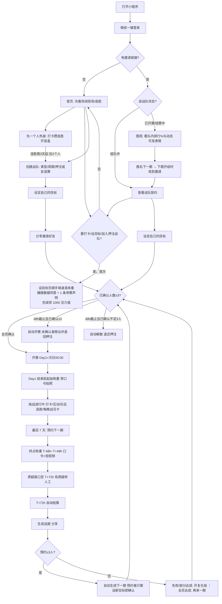

# FitSquad 瘦身战队 · MVP 产品需求文档（PRD v0.8）

> 版本：v0.8 ｜ 日期：2026-10-24 ｜ 主体：个体工商户 ｜ 平台：微信小程序 ｜ 变更见第 11 节

## 1. 产品概述

**一句话定位**：熟人 / 同事（公司、部门、好友、家庭）3 人起组队较劲，立下减重契约、押上赚来的活力值，比谁更能坚持。全员达成拿系统大奖，部分达成也有奖池分成。

**产品灵魂**：不是一个减肥 App，是「熟人之间每天互相盯梢、互相嘲」的小游戏。瘾点在"我在这群人里排第几 + 有人在看我"，不在"我瘦了多少"。设计走**奶油纸 + 黑色粗字 + 荧光绿点睛**（像一张熟人之间的战书）：一屏一主角、大留白、超大黑色数字、贴纸式按钮和小人；上手不动脑，像游戏一样越玩越想玩（v0.8 起替代原深色潮玩风，色值见 `mockup/SHARED-SPEC.md`）。

| 人群 | 特征 | 核心诉求 |
|---|---|---|
| 同事 / 公司（部门、工位邻居） | 25–40 岁久坐职场人，BMI ≥ 24，一个人坚持不下去 | 同事之间较劲、有人监督、每天有话题；也是通向企业版（2.1）的核心场景 |
| 好友 / 饭搭子 | 同学、球友、饭搭子；含体重正常、想控体重养成运动习惯的人 | 好胜心、社交乐趣、习惯养成（V1.1 维持挑战） |
| 家庭 / 亲友 | 夫妻、兄弟姐妹、闺蜜 | 一起做件事，有话题（可先玩 0 押注友谊赛） |

**MVP 唯一核心假设**：熟人 / 同事组队能否带来高留存 + 自发裂变。MVP 不验证电商、充值、工具类功能。

**两条产品原则（v0.6）**：
- **容易上手（不动脑）**：从打开到"爽第一次"尽量 30 秒内、点 3 下。登录后先看"热闹现场"再引导组队（先逛再组队）；登录只要微信授权，身高体重在第一次设目标时顺手填（v0.8 取消独立身体档案页），手机号推迟到第一次押注；每屏一个主按钮；打卡打开即相机，拍完立刻给反馈。
- **越玩越想玩（留存三件套）**：连胜（个人连胜 + 免断卡 + 队伍连胜）、社交钩子（每天一条 + 每晚战况卡）、打卡后盲盒式可变奖励。只做这三类，详见 4.14。段位 / 赛季 / 战队 PK 等重规则留到 V1.1。
- **不让人掉在缝里（v0.7）**：用户最容易流失的不是挑战中，而是四个缝——凑不齐 3 个人、看到分享卡却加不了队、两期之间的空档、第一次失败。分别用「单人热身」（G-06）、「围观 + 报名下一期」（T-19）、「预约下一期」（T-17）、「首期默认友谊赛 + 复仇局」（T-03 / T-18）补上。

**MVP 验证目标**（3–5 支队、15–25 人跑一期）：每队自发带来新用户 ≥ 1 人（裂变系数 K，**自发裂变是第一判据**）；30 天打卡留存 > 50%；达成率 > 40%；愿意参加第二期 > 60%。

## 2. 范围

**V1.0 包含**：微信登录（手机号推迟到首次押注时绑定）；首次设目标时填身高体重（含健康数据单独同意 + 1 条参赛声明，完成领 1000 活力值）；积分账户与流水（活力值）；创建 / 加入战队（3–10 人，周期队伍自选，个人目标，押注或 0 押注友谊赛）；契约确认与 48 小时自动开赛；称重打卡（口令照片 / 终点短视频）+ 微信运动步数 + 生活打卡；队内动态、表情回应（含调侃表情）、催一下（分享卡片）、线下趣味惩罚（选填）；终点互审 + 人工审核；自动结算；队内排行、好友榜、周称号、超越提醒；分享海报；简易后台；留存三件套（个人连胜 + 免断卡、队伍连胜、每天一条社交钩子、每晚战况卡、打卡盲盒）；预约下一期、复仇局、分享落地页围观 + 报名下一期（v0.7）。

| 暂不包含 | 版本 | 原因 |
|---|---|---|
| 健康知识 / 内容文章 | 以后再说（MVP 不做） | Keep / 薄荷 / 小红书上又多又好，不是差异化；且要内容官每天产出、人工审核，成本高。站内不做，站外增长内容照常 |
| 新手引导玩法介绍页 | 以后再说（MVP 不做） | 大多被跳过，玩法在契约页（战书）一眼看清；登录后直接进首页 |
| 全站战队榜 / 个人总榜 | 以后再说（MVP 不做） | 种子期只有 3–5 支队，全站榜是空的，和陌生人比也没有压力；较劲感来自熟人，只留好友榜 + 队内排行 |
| 积分商城（虚拟装扮 / 运动好物 / 实物发货 / 公益） | 以后再说（MVP 不做） | 先验证熟人社交留存与裂变，不做会稀释焦点的电商 / 工具模块；未来若上线，作为活力值消耗出口 |
| 充值积分（花钱买积分） | 以后再说（MVP 不做） | 先验证熟人社交留存与裂变，不做会稀释焦点的电商 / 工具模块；且有对赌风险 |
| 维持挑战（减重挑战结束后 30 天体重保持在 ±1kg 内） | V1.1 | 防反弹，也适合体重正常的健康管理人群 |
| 体脂 / 腰围类目标 | V2.0 | 测量标准和防作弊方案待定 |
| 公司榜 / 企业版 | 第二阶段（变现主线，见 2.1） | 先用 MVP 验证同事组队留存与裂变，再拿去给 HR 卖 |
| 智能秤对接 | V2.0 | 需要硬件合作 |
| 抖音 / 支付宝小程序 | V2.0 | 先跑通微信 |

**红线（永不做）**：积分提现、转让、兑换现金；充值积分参与押注或进入奖池；任何"花钱下注、赢了拿现金或实物"的变种；医疗、治疗、药物减肥相关表述和商品。

### 2.1 第二阶段：企业版（「先2后1」的 1）
MVP（先2）跑通熟人 / 同事组队较劲之后，企业版是第一条变现主线，提前到第二阶段，不再放在 V2.0。

- **功能**：HR 采购开通；公司榜；部门 PK；HR 数据看板（只看参与率 / 打卡率 / 平均减重 %，不看个人 kg）；定制奖品（企业出资，线下发放）；按人头年费。
- **MVP 已埋的桥梁**：战队类型"公司"+ 公司名（T-13）、同事组队场景、战队榜。
- **启动条件**：MVP 核心假设成立（第 1 节指标达标），且出现企业线索。

## 3. 核心流程



## 4. 功能需求

### 4.1 用户
| ID | 需求 | 说明 |
|---|---|---|
| U-01 | 微信登录 | `wx.login` 拿 openid，首次进入自动建档 |
| U-02 | 手机号绑定 | **v0.8：推迟到第一次加入或发起押注战队时**才授权（手机号快速验证组件，按次收费）；手机号唯一，一号一账号。友谊赛、单人热身、围观、报名下一期都不需要 |
| U-03 | 身高体重（v0.8） | 不再有独立的身体档案页。第一次设目标（第 6 页）时在同一屏填 2 项：身高 cm、体重 kg（1 位小数），自动算 BMI；老用户再加入只确认今天体重。**性别不收集**（没有规则用到）；出生年份不收集，改为声明“已满 18 岁”（U-04）。身高、体重、照片属于健康生理类敏感个人信息：同一屏须**单独勾选**“我单独同意 FitSquad 处理我的身高、体重和称重照片，仅用于目标计算、打卡与结算”（附《隐私政策》链接，不能默认勾选，不能和其他声明合并）。首次完成即领新人 1000 活力值 |
| U-04 | 健康准入（v0.8 合并为 1 条参赛声明） | 设目标页 1 条勾选：“我已满 18 岁，没有孕期 / 哺乳期 / 进食障碍史 / 基础疾病”（替代原出生年份 + 5 项不适宜人群 + 两处免责）。点“我有其中一项”：可参加友谊赛、打卡和单人热身，但不能押注、不能设减重目标，提示先咨询医生。BMI < 18.5 不能设减重目标。老用户再加入时只确认“身体情况没变化” |
| U-05 | 个人主页 | 累计减重、参加 / 达成次数、徽章墙 |
| U-06 | 隐私 | 具体体重（kg）默认仅本人可见；队友看到减重百分比和目标百分比；本人可在隐私设置中开启"向队友显示具体体重"；对外（排行榜、海报、邀请页）只显示百分比 |
| U-07 | 注销账号 | 进行中的挑战视同中途退出（见 4.5） |

> 微信不开放好友列表，"好友"= 邀请关系 + 曾同队的人。

### 4.2 积分
V1.0 只有一种积分：活力值。

| 类型 | 来源 | 可押注 | 用途 | 说明 |
|---|---|---|---|---|
| 活力值（赚来的积分） | 新人 1000、打卡、步数、邀请、结算所得 | ✓ | 仅用于押注与荣誉体系（徽章 / 称号，纯虚拟） | V1.0 唯一积分类型；冻结中（押注中）的部分不能再次押注 |

| ID | 需求 | 说明 |
|---|---|---|
| P-01 | 账户 | 活力值：可用、冻结（押注中）、累计获得（累计获得只统计净赚入，不含押注退回与押注冻结） |
| P-02 | 新人奖励 | 注册并完善档案 +1000 活力值 |
| P-03 | 流水 | 每笔变动记账（注明积分类型），不可删改 |
| P-04 | 通用规则 | 所有积分不可提现、不可转让 |
| P-05 | 有效期 | 12 个月滚动：每笔积分自获得之日起 12 个月后到期 |
| P-06 | 活力值用途 | MVP 只用于押注与结算内流转 + 徽章 / 称号纯虚拟荣誉；不设商城、不设实物出口；积分负债口径见解决方案第 7 节 |
| P-07 | 不重复计 | 打卡类积分（称重、步数、连续 7 天）按人计，每人每天只算一次；每人同时只能参加 1 支战队（T-14），不存在跨战队重复计分 |

| 获取途径（均为活力值） | 积分 | 限制 |
|---|---|---|
| 称重打卡 | +5 | 每天 1 次 |
| 步数 ≥ 8000 | +5 | 每天 1 次 |
| 连续 7 个有效打卡日 | +30 | 每周 1 次 |
| 邀请新人 | +200 | 被邀请人完成首期挑战且打卡率 ≥ 50% 后发放；每月最多 10 人 |
| 挑战结算 | 见 4.5 | — |

| 消耗途径 | 积分 | 限制 |
|---|---|---|
| 押注 | −S（冻结，结算时释放） | 只能用可用活力值 |

### 4.3 战队
| ID | 需求 | 说明 |
|---|---|---|
| T-01 | 创建（v0.8 一屏） | 一屏 4 项、全部预填，不改也能直接发起：队名（默认“XX 的战队”）、和谁（同事 / 好友 / 家人，对应公司 / 好友 / 家庭类型）、周期、押注；队徽（默认 🔥）、口号（默认不设）、线下惩罚（T-16）收进“更多设置”；结算规则缩成一句话，长版点“完整规则”。下一步直接进设目标页的队长发起态 |
| T-02 | 周期 | 队伍自选 14 / 21 / 30 / 60 天 |
| T-03 | 押注 | 全队统一，队长定：每人 100 / 200 / 500 / 1000 活力值，或 0 押注「友谊赛」。**首期默认（v0.7）**：队长从未完成过任何挑战时，建队页默认选中「友谊赛 · 21 天」，标"新手推荐"，可手动改；完成过挑战的队长按正常默认（沿用上次配置）。押注战队的契约 / 邀请落地页对首次参赛的人加一句"第一次参赛失败，押注由系统回收、不进奖池，坚持奖照常"（与 4.5 新用户规则一致），让新人知道最坏情况 |
| T-04 | 友谊赛 | 0 押注：不进奖池、无系统奖励积分，只发徽章；用于降低亲友冷启动门槛 |
| T-05 | 人数 | 3–10 人；v0.8 起建队时不再选人数上限，默认 10 |
| T-06 | 个人目标 | 每人自定减重 kg，按 4.4 校验；开赛前可修改，修改后只需其他成员对"该成员的目标"重新确认；开赛后锁定 |
| T-07 | 邀请 = 战书（v0.8） | 小程序卡片 / 海报二维码，打开即见契约。卡片、海报、落地页统一做成“战书”：发起人头像 + “XX 向你下了战书” + 队长在设目标页从 3 句里挑的一句狠话（“谁先摸鱼谁请客，不服来战” / “N 天后，秤上见” / “别说明天开始了，就今天”）+ 关键规则 5 行（怎么赢 / 押多少 / 拿多少 / 输了 / 开赛）。落地页不再要求勾选“我已阅读”，按钮“接下战书，押 N 上车”即表示同意（下方小字链接免责声明） |
| T-08 | 契约确认 | 成员确认周期、押注、每人目标、结算规则；已确认 ≥ 3 人且全员确认即开赛 |
| T-09 | 48 小时截止 | 建队后 48 小时截止时：已确认 ≥ 3 人即自动开赛，未确认成员自动移出并退回押注；已确认 < 3 人则自动解散，押注全部退回 |
| T-10 | 移出成员 | 队长可随时移出未确认成员，押注退回 |
| T-11 | 开赛时间 | Day 1 = 开赛次日 00:00（北京时间）；起始称重须在 Day 1 结束前完成，否则视为未开赛，移出并退回押注 |
| T-12 | 开赛后变动 | 开赛后不能新加入成员；有人退出导致少于 3 人时挑战照常继续；队长退出时自动转给加入最早的成员 |
| T-13 | 公司名 | 类型为公司时可填（第二阶段企业版用于公司榜 / 部门 PK） |
| T-14 | 并行限制 | 每人同时只能参加 1 支进行中或待开赛的战队；这期结束（结算 / 解散 / 退出）后才能加入或创建下一支 |
| T-15 | 再来一期 | 一键复制配置重新确认；新战队记录 `prev_team_id` 指向上一期（用于复参率和"第 N 期"展示） |
| T-17 | 预约下一期（v0.7） | 挑战最后 7 天起（Day ≥ 周期 − 6），战队主页和终点称重页出现「预约下一期」：成员一键勾选"下期继续"，可随时取消；队长可预设下期周期 / 押注（默认沿用本期）。T+72h 结算完成时（有人工审核则随结算延后）：预约 ≥ 3 人 → 系统自动复制配置生成下一期战队（status = forming，`prev_team_id` = 本期），并通知预约成员；预约者只需按新体重设定个人目标即视为已确认，其余规则（T-08 / T-09 / T-11 的 48 小时截止、Day 1 = 次日 00:00、起始称重）不变；未预约的原成员和 T-19 报名者收到邀请卡，可照常加入。预约 < 3 人 → 不自动建队，结算页主按钮回到 T-15 / T-18。预约不占 T-14 名额 |
| T-18 | 复仇局（v0.7） | 结算结果为部分达成或全员失败时，结算页（失败者视角和达成者视角）主按钮为「开复仇局」：等同 T-15 再来一期，队名默认加后缀"· 复仇局"，契约页顶部显示上期战绩（全队平均 % / 达成人数，只显示百分比）；押注默认沿用上期，若发起人是首期失败的新用户则默认友谊赛，均可改。上期失败、本期参加的成员获得纯虚拟标签"🗡 复仇者"（仅本期队内显示）。全员达成时主按钮仍为"再来一期" |
| T-19 | 围观 + 报名下一期（v0.7） | 所有分享卡 / 海报 / 邀请卡的落地页（契约页）按战队状态分流：组队中 → 现有"我也加入"；已开赛 / 结算中 → 「围观」+「报名下一期」。围观：无需填身高体重，只读查看队内排行（只显示 % 和目标 %，遵守 U-06 对外口径）、周称号（只显示 4 个正向称号）、动态文字，可发表情回应（不计入周称号统计）；**打卡照片、视频、kg 对围观者永不可见**。报名下一期：需登录、不需档案，进入该队下期报名名单，引导订阅一条"下期开组通知"（C-10 一次性额度）；下一期生成（T-17 自动或 T-15 / T-18 手动）时，报名者收到邀请卡和通知。队长可在战队设置里关闭围观（默认开启）。T-12 不变：开赛后仍不能加人 |
| T-16 | 线下趣味惩罚（选填） | 建队页“更多设置”里由队长选一项：请全队喝无糖茶 / 朋友圈发认输海报 / 下期当监工（负责每天催打卡）/ 不设置；写进契约，结算失败页提醒"愿赌服输"。纯线下自觉执行，平台不记录是否执行、不涉及任何积分，也不影响结算 |

### 4.4 健康目标上下限（系统强制）
```
周数 = 天数 / 7
目标下限(kg) = max( 0.5 , 周数 × 0.25 )
目标上限(kg) = min( 周数 × 1.0 , 初始体重 × 8% , 初始体重 − 20 × 身高(m)² )
（上限结果四舍五入保留 1 位小数；下限按各周期固定值展示：0.5 / 0.75 / 1.1 / 2.1；上限最后一项保证结束时计划 BMI 不低于 20）
```
| 周期 | 下限 | 上限：70kg / 175cm | 上限：90kg / 175cm | 上限：55kg / 160cm |
|---|---|---|---|---|
| 14 天 | 0.5 | 2.0 | 2.0 | 2.0 |
| 21 天 | 0.75 | 3.0 | 3.0 | 3.0 |
| 30 天 | 1.1 | 4.3 | 4.3 | 3.8（BMI 20 限制） |
| 60 天 | 2.1 | 5.6 | 7.2 | 3.8（BMI 20 限制） |

超上限不能提交，提示"健康减重建议每周不超过 1kg"；低于下限不能提交。上限低于下限时，该周期不能设减重目标（可换更短周期，或参加打卡）。页面常驻免责：本产品不提供医疗建议，有基础疾病请先咨询医生。

### 4.5 结算规则
- S = 每人押注；R = 系统奖励基数：14 天 100 ｜ 21 天 150 ｜ 30 天 200 ｜ 60 天 400
- 达成 = 终点体重 ≤ 起始体重 − 目标，且终点称重审核通过；起始体重定义见 C-02
- 打卡率 = 有效打卡日 / 挑战天数（有效打卡日定义见 C-07，每周上限见 C-04）

| 情况 | 达成者 | 失败者 |
|---|---|---|
| ① 全员达成 | 退回 S + 系统奖励 R + 全员加成 0.5×S + "铁血战队"徽章 | — |
| ② 部分达成 | 退回 S + 奖池分成 min(奖池 ÷ 达成人数, 0.5×S) + 系统奖励 0.5×R | 打卡率 ≥ 80%：返还 0.3×S（坚持奖），其余进奖池；否则全部进奖池 |
| ③ 全员失败 | — | 打卡率 ≥ 80%：返还 0.3×S，其余系统回收 |

- 奖池分成向下取整；奖池超出上限的部分和取整余数由系统回收（积分回收，不归任何人）。平台不抽成。
- 新用户（注册 < 14 天或首次挑战）失败时，押注不进奖池，由系统回收（坚持奖照常）。
- 友谊赛（S = 0）：不进奖池、无系统奖励积分，只发徽章。

**不变式**：任何情况下，达成者在全员达成时拿到的积分都严格多于部分达成时，结算差额 ≥ 0.5×R。
友谊赛（0 押注）没有积分结算，不适用该不变式。
推导：① − ② = (R + 0.5×S) − (min(奖池 ÷ 达成人数, 0.5×S) + 0.5×R) ≥ 0.5×R > 0。达成者不会因队友失败而多拿。

**例子**：5 人、S = 200、30 天（R = 200）；3 人达成，Lily 失败（打卡率 85%），大刘失败（打卡率 40%）。

| 成员 | 计算 | 到账 |
|---|---|---|
| Lily（失败，85%） | 坚持奖 0.3 × 200 = 60；进池 140 | 60 |
| 大刘（失败，40%） | 进池 200 | 0 |
| 奖池 | 140 + 200 = 340；340 ÷ 3 = 113 超上限 0.5×S = 100 | 每人分 100，系统回收 40 |
| 每位达成者 | 退回 200 + 奖池分成 100 + 系统奖励 0.5 × 200 = 100 | **400** |
| 对照：全员达成 | 退回 200 + 系统奖励 200 + 全员加成 100 | **500** + 铁血战队徽章 |

**结算时间线**（T = 挑战最后一天 24:00，北京时间）：

| 时间 | 事件 |
|---|---|
| T−48h ~ T+48h | 终点称重窗口（C-03） |
| 至 T+72h | 质疑窗口，T+72h 关闭（4.7） |
| T+72h | 自动结算；若有成员在人工审核中，全队一起延后结算，审核须在 72 小时内完成（最晚 T+144h），超时未审视为审核通过 |

**特殊情况**：中途退出（含注销账号）→ 视同失败、无坚持奖，押注进奖池（新用户由系统回收）；T+48h 前未完成终点称重 → 失败；终点作弊 → 失败并扣信用分。

### 4.6 打卡
| ID | 需求 | 说明 |
|---|---|---|
| C-01 | 称重标准 | 晨起、空腹、如厕后、轻衣、同一台秤；打卡页常驻提示 |
| C-02 | 起始称重 | 秤读数 + 当日 4 位口令（写纸上入镜）同框拍照，只能现场拍；Day 1 结束前完成。起始体重 = min(起始带口令称重, 近 7 天内档案或打卡体重)（有数据时） |
| C-03 | 终点称重 | 窗口 T−48h ~ T+48h；带口令拍照 + 3–5 秒上秤短视频（相机现场录制，不能选相册） |
| C-04 | 日常称重 | 拍照打卡（秤读数入镜即可，不需要口令），每天最多 1 次；周的划分：从 Day 1 起每 7 天为一周，最后不足 7 天的尾周至少称重 1 次；完整周要求至少 2 次，当周不足 2 次则该周有效打卡日最多计 5 天（影响打卡率和坚持奖，不直接影响达成判定）；可对队友隐藏具体体重 |
| C-05 | 步数 | `wx.getWeRunData` 自动同步 |
| C-06 | 生活打卡 | 饮食 / 运动照片 + 一句话 |
| C-07 | 有效打卡日 | 当天完成以下任一项：称重 / 步数 ≥ 6000 / 饮食或运动打卡；打卡率 = 有效打卡日 / 挑战天数（当周称重不足 2 次时该周最多计 5 天，见 C-04） |
| C-08 | 补卡 | 不支持 |
| C-09 | 内容安全 | 图文过微信内容安全接口 |
| C-10 | 提醒 | 微信订阅消息基本是一次性授权（每次授权只能发一条），不做"每日固定提醒"承诺：每次打卡完成后引导"订阅明天的提醒"；开赛时引导订阅结算通知；T-19 报名下一期时引导订阅"下期开组通知"；"催一下"和每晚战况卡（G-05）走分享卡片，不消耗订阅额度。**战队所在的微信群才是每天能触达的主渠道** |
| C-11 | 照片 / 视频保留 | 打卡照片和视频在结算后 30 天删除，保留图片哈希用于风控 |

### 4.7 队内互动
- 队内动态：打卡、生活打卡、里程碑（"小王已减 3%"，默认显示百分比）
- 表情回应（v0.8 减到 3 个）：加油 💪 / 就这？ / 你礼貌吗（后 2 个为调侃表情，文字气泡样式）
- 催一下 = 今日战况卡（v0.8 与 G-05 合并为一个动作）：点某个未打卡成员的“催一下”，生成当天战况卡（已打卡 N/M + 队伍连胜 + “@大刘 你的体重秤说它很想你 ⚖️”），发到战队群或私聊；不消耗订阅消息额度；每人每天最多 3 次；被催次数计入“嘴硬王者”统计（见 R-06）
- 线下趣味惩罚：建队时选填（T-16），契约页和结算失败页展示，不涉及积分
- 终点互审：队友可"认可 / 质疑"终点称重。质疑必须选择理由（读数看不清 / 口令不符 / 疑似非本人 / 疑似换秤 / 视频疑似非现场 / 其他）；质疑不会直接判失败，只会把该成员转人工审核；质疑被驳回累计 2 次，扣质疑人信用分 10。质疑窗口 T+72h 关闭

### 4.8 排行榜
| ID | 榜单 | 规则 |
|---|---|---|
| R-01 | 队内排行 | 按减重百分比排序；自己看 kg + %；队友之间显示 % 和目标 %（kg 仅本人可见，是否向队友显示由本人设置） |
| R-04 | 好友榜 | MVP 唯一的全局榜：邀请关系 + 曾同队的人，按活力值排名；较劲感来自熟人，不设全站榜 |
| R-05 | 公司榜 / 全站战队榜 | 第二阶段（企业版，见 2.1）；种子期只有 3–5 支队，全站榜没有意义，和陌生人比也没有压力 |
| R-06 | 周称号（v0.8 减到 4 个） | 每周（从 Day 1 起每 7 天）结束后在队内自动颁发，只按行为 / 数据评，不看体型：卷王（本周减重 % 第一）、打卡钉子户（本周 7/7 有效打卡）、嘴硬王者（本周被催次数最多）、摸鱼选手（本周有效打卡最少，温和调侃）。按上述顺序颁发，每人每周最多 1 个称号，已占用时顺延给下一名（打卡钉子户可多人同时获得）；摸鱼选手不顺延，并列最少或最少者已有称号时本周空缺。展示在战队主页和队内排行；好友榜对非队友只显示 2 个正向称号（卷王 / 打卡钉子户），嘴硬王者、摸鱼选手只队内可见。友谊赛同样颁发；仅 1 人有数据时不颁发。另有开赛前夜竞猜称号「🔮 神预言」（G-07），不占每周名额 |
| R-07 | 超越提醒 | 好友 / 队友在减重 % 上反超你时（双方都有进行中挑战，比较各自本期减重 %；在打卡写入后由云函数判定），下次打开首页和战队主页顶部出现横幅（文案示例：「⚠️ 你被 Lily 反超了 0.3%！她让我转告你：'就这？'」），按钮「不服，去打卡」→ 打卡页、「发给她：等着」→ 生成分享卡片发微信。只做小程序内横幅 + 分享卡片，不发订阅消息（不占 C-10 额度）；每人每天最多出现 1 次，取差值最大的一条；只比较百分比，不出现 kg |

### 4.9 分享海报
周战报（每周一生成，含本周称号）；结算战报（达成版 / 失败自嘲版，设了线下趣味惩罚的队可直接生成"认输海报"）；邀请海报（小程序码 + 契约摘要）；超越分享卡（R-07）；每晚战况卡（G-05，与催一下同一张卡）；开赛前夜“猜猜谁先摸鱼”卡（G-07）。邀请卡与邀请海报统一为“战书”（T-07）。默认只显示百分比，文案按 4.13。所有卡片的小程序码落地到契约页，按 T-19 分流（组队中 → 加入；已开赛 → 围观 / 报名下一期），不允许出现"点进来什么都做不了"的死路。

### 4.11 运营后台
用户查询与封禁；战队查询与手动重算；终点称重人工审核（含质疑理由、短视频）；风控告警；积分手动调整（必填原因、留日志）。

### 4.13 文案规范
产品语气：诙谐、搞怪、互相调侃，激发好胜心——像同事之间打赌，通过好友排名和组队一起把体重和健康管住。所有页面、海报、分享卡、提醒、Agent 产出都遵守以下红线：

1. **只调侃行为**：偷吃、摸鱼、熬夜、赖床、嘴硬、不打卡。
2. **绝不调侃身体**：不拿体型、体重数字、长相、性别、年龄、健康状况开玩笑；文案里不出现具体 kg。
3. **失败不羞辱**：失败文案用自嘲 + 约定复仇（如"这期我先给队友当垫脚石，下期见"），不点名嘲笑失败者。
4. **不鼓励极端节食**：不出现"宁可挨饿也要瘦""不吃晚饭"这类说法，不鼓励断食、催吐、脱水、过量运动。
5. **调侃 = 友好较劲，不是羞辱**：被调侃的人看了会笑、想回嘴，而不是难受；可以用 emoji。

文案语气库和各场景示例见 `03-Mockup提示词.md` 第 6 节；运营文案按 `ops/agents/content.md` 执行。

### 4.14 留存三件套（游戏化，v0.6，v0.7 补强）
只做三类最强、又最不需要用户动脑的机制：**连胜**（G-01 个人连胜 + 免断卡、G-04 队伍连胜、G-06 单人热身）、**社交钩子**（G-02 每天一条、G-05 每晚战况卡 = 催一下、G-07 开赛前夜）、**盲盒**（G-03）。**v0.8 原则：首页只有一个连胜数字**——在队里时是队伍连胜（G-04），个人连胜和免断卡退成一行小字（完整在“我的”页）；没队伍时（含单人热身）是个人连胜。其余（段位、赛季、战队 PK）留 V1.1。

| ID | 机制 | 说明 |
|---|---|---|
| G-01 | 个人连胜 Streak | 连续有效打卡日 +1，断一天清零（有免断卡时见下）。首页主角就是这个超大数字（"连续打卡 9 天 · 别断在今天"）。断签前一天给一次挽回提醒（走 C-10 订阅额度或应用内横幅）。里程碑（7 / 14 / 30 天）解锁纯虚拟徽章 / 称号，不额外发积分以外奖励。**不在赛时也能续（v0.7）**：没有进行中战队的用户（组队中、结算中、两期之间、从未组过队）都可以通过 G-06 单人热身打卡续连胜，但不计入任何战队打卡率，避免空档把连胜断掉。记录字段见第 7 节 `streak_days` / `streak_best`。 |
| G-01a | 免断卡（v0.7） | 个人连胜每累计满 7 天自动获得 1 张「🧊 免断卡」，最多持有 2 张。某天没有有效打卡时自动消耗 1 张：连胜数字保持不变（当天不 +1、不清零），次日继续累计；没卡才清零。**只保护连胜这个纯虚拟数字**：不算有效打卡日，不影响打卡率、坚持奖、达成判定、"连续 7 个有效打卡日 +30"积分和任何结算；不可购买、不可转让、不可兑换。与 C-08"不支持补卡"不冲突——补卡改的是打卡记录，免断卡只改连胜展示。首页连胜旁显示持有数（🧊×1）；消耗当天首页给一句"昨天断了，免断卡替你挡了一刀，剩 0 张"。记录字段 `streak_freeze`，产出 / 消耗写 `reward_log`。 |
| G-02 | 社交钩子（每天一条） | 首页 / 战队主页每天只出现一条最扎心的：被谁反超（复用 R-07 超越提醒）或谁在群里 @你（复用催一下）。一条，不是一堆；配一个动作按钮（回怼 / 去打卡）。取差值最大 / 最新的一条。只做应用内横幅 + 分享卡片，不额外消耗订阅额度。 |
| G-03 | 盲盒式可变奖励 | 每日打卡成功后进"开盲盒"爽点页：开出的结果每天不同——连胜 +1 / 排名反超某人 / 抽到盲盒表情 / 随机鼓励语 / 获得免断卡（满 7 天时）/ 队伍连胜 +1（自己是全队最后一个打卡时："你补上了最后一块，队伍连胜 6 天"）。一个大数字 + 一句话 + "晒给队友"。奖励均为纯虚拟，**不发可押注 / 可结算的额外活力值，不碰积分经济与结算公平**（打卡本身的 +5 照常，见 4.2）。盲盒产出记录见第 7 节 `reward_log`。 |
| G-04 | 队伍连胜（v0.7） | 当天所有在赛成员（已开赛、未退出）都有有效打卡日 → 队伍连胜 +1；任一人缺 → 清零（队伍连胜不适用免断卡，压力就在这里）。战队主页第一屏的主角数字就是队伍连胜（"全队连续 6 天没人掉链子"）。每天 20:00 起，当天还没打卡的成员在战队主页亮红点并显示"就差 TA"，队友一键"催一下"（4.7）。里程碑 7 / 14 / 30 天解锁纯虚拟队伍徽章，展示在战队主页和周战报。只看行为（有没有打卡），不看体重，符合 4.13。字段 `teams.team_streak` / `team_streak_best`。 |
| G-05 | 每晚战况卡（v0.7，v0.8 与催一下合并） | 每天 20:00 起，战队主页出现「今日战况」卡：已打卡 N/M、还差谁（只显示昵称）、队伍连胜几天、一句调侃（"就差 @大刘，队伍连胜 6 天悬了"）。任一成员可一键分享到战队微信群（分享卡片，不消耗订阅额度）；全员已打卡时卡片变为"今日全员到齐 ✓ 队伍连胜 +1"。每队每天只生成一张，不推送。。v0.8：战况卡就是“催一下”生成的那张卡（4.7），点某人的“催一下”会在卡上 @ 他，不再是两个功能 |

| G-06 | 单人热身（v0.7） | 解决"凑不齐 3 个人就什么都玩不了"的冷启动。没有进行中战队的用户，首页无队状态多一个入口「先一个人热身」：每天完成任一打卡项（步数 ≥ 6000 / 生活打卡；称重需先填身高体重并单独同意健康数据）即计入个人连胜（G-01）、开盲盒（G-03）、攒免断卡（G-01a）。**热身不押注、不结算、不进好友榜和任何排行，也不发打卡类活力值**（防小号刷积分；新人 1000 照常在完善档案时发放）。热身连胜在加入或创建战队后原样带入。引导：热身连胜第 3 天起，首页钩子固定为"连胜 3 天了，拉 2 个人，连胜带进战队"，按钮"去组队"（→ 创建战队）/"发邀请"（→ 邀请海报）。热身打卡记录 `checkins.team_id` 为空，照片规则同 C-11。 |
| G-07 | 开赛前夜 · 猜猜谁先摸鱼（v0.8） | 确认契约到 Day 1 00:00 之间，战队主页只放一个玩法：每人投 1 票猜“第 1 周有效打卡最少的人”（可投自己），票数不公开，第 7 天随周战报揭晓；猜中者得纯虚拟称号「🔮 神预言」（不占 R-06 每周名额）。投完可把“猜猜谁先摸鱼”卡转进群。同屏提醒 Day 1 起始称重 + 引导订阅 1 条开赛提醒。不涉及积分，只针对“摸鱼”行为。记录见第 7 节 `eve_votes` |

- 三件套都不改变结算、奖池、积分负债口径；连胜、免断卡、队伍连胜、盲盒、单人热身只产出纯虚拟物。
- 文案遵守 4.13 红线（只调侃行为、不调侃身体）；"就差 TA"只针对没打卡这个行为。

## 5. 风控规则
| 规则 | 触发 | 处理 |
|---|---|---|
| 体重异常 | 单日降 > 1.5kg 或单周降 > 2.5kg | 标记，要求补拍口令照 |
| 照片重复 | 图片哈希与历史相同 / 相似 | 打卡无效 |
| 起始体重偏差 | 起始称重高于近 7 天档案或打卡体重 | 起始体重取较低值（C-02） |
| 终点称重不合规 | 缺口令、缺短视频、不在 T−48h ~ T+48h 窗口 | 判未完成终点称重 |
| 终点被质疑 | 任一队友带理由质疑 | 转人工审核，不直接判失败；全队延后结算（≤ 72 小时，超时视为通过） |
| 恶意质疑 | 质疑被驳回累计 2 次 | 质疑人信用分 −10 |
| 多账号 | 同设备 / 异常聚集 | 人工复核 |
| 新用户失败 | 注册 < 14 天或首次挑战的账号失败 | 押注不进奖池，系统回收（防止小号送分给大号） |
| 刷邀请 | 被邀请人未完成首期挑战，或打卡率 < 50% | 不发邀请奖励 +200 |
| 信用分 | 初始 100，作弊一次 −30，恶意质疑 −10 | < 60 禁止押注挑战 |

## 6. 页面清单
| # | 页面 | 主要元素 |
|---|---|---|
| 1 | 启动 / 登录 | 品牌、Slogan、微信一键登录（不授权手机号）、协议勾选 |
| 3 | 首页 | 有队：连胜大数字 + 免断卡持有数、一条社交钩子、进行中战队、今日打卡、榜单入口；无队：创建战队 / 邀请码 / 先一个人热身（G-06）；热身中：热身连胜 + "拉 2 个人带进战队"钩子 + 打卡 CTA |
| 4 | 创建战队（一屏） | 队名 / 和谁 / 周期 / 押注全部预填，更多设置（队徽 / 口号 / 线下惩罚）折叠；下一步进设定目标页队长发起态 |
| 5 | 契约详情 / 邀请落地页 | 组队中：成员、每人目标（%）、押注、规则、线下趣味惩罚、48 小时截止说明、首次参赛友谊赛提示、我也加入；已开赛 / 结算中：围观态（队内排行 %、队伍连胜、动态、表情回应）+ 报名下一期（T-19） |
| 6 | 设定个人目标（含身高体重） | 第一次：身高 + 今天体重 2 格、目标滑杆（默认推荐值、健康上下限，公式收进“为什么是这个范围？”）、1 条参赛声明 + 健康数据单独同意，完成弹 +1000；老用户：只确认今天体重；队长发起：战书预览 + 3 选 1 狠话 |
| 7 | 战队主页 | 队伍连胜（主角数字）、倒计时、全队进度、本周称号、超越提醒横幅、队内排行（% / 目标 %，20:00 后未打卡者“就差 TA”）、催一下 = 今日战况卡、动态（3 个表情）、开赛前夜“猜猜谁先摸鱼”（G-07）、最后 7 天预约下一期 |
| 8 | 打卡 | 称重标准、相机 + 口令、终点短视频、体重、步数、生活打卡、订阅明天提醒；终点称重页带「预约下一期」（T-17） |
| 9 | 结算结果 | 达成 / 失败、积分明细、徽章、线下趣味惩罚提醒（失败页）、分享；主按钮：已预约 ≥3 人 → "下一期已开组"；部分达成 / 全员失败 → "开复仇局"（T-18）；全员达成 → "再来一期" |
| 10 | 排行榜 | 好友榜（按活力值），周称号标签 |
| 11 | 积分中心 | 活力值余额、冻结、流水、有效期、赚积分任务 |
| 13 | 我的 | 数据、徽章、历史战队、身高体重、个人连胜 + 免断卡、隐私设置、企业认证（第二阶段）、协议 |
| 14 | 分享海报 | 周战报 / 结算 / 邀请；超越分享卡 |

## 7. 数据模型（云开发）
```text
users          openid, phone(首次押注时绑定), nickname, avatar, height_cm,
               weight_kg, bmi, credit_score, invited_by, health_consent_at,
               declare_at(参赛声明时间), declare_unfit(勾了“我有其中一项”),
               show_kg_to_team, profile_done(身高体重是否已填),
               streak_days(当前连胜), streak_best(最佳连胜), last_checkin_date,
               streak_freeze(免断卡持有数 0–2), warmup_started_at(单人热身开始时间),
               created_at, deleted_at
point_accounts user_id, vitality_available, vitality_frozen, vitality_total_earned
point_ledger   user_id, point_type(vitality，预留扩展), type, amount(+/-), balance_after,
               expire_at, ref_team_id, remark, created_at
teams          name, icon, type, company_name, captain_id, period_days, stake(0=友谊赛),
               max_size, status(forming|active|settling|settled|dissolved),
               start_code, end_code, form_deadline, start_at, day1_at, end_at,
               offline_penalty(tea|lose_poster|supervisor|none),
               prev_team_id(上一期), period_no(第几期), is_revenge(复仇局),
               team_streak(队伍连胜), team_streak_best, spectate_on(允许围观，默认 true),
               next_period_days, next_period_stake(队长预设下期配置)
next_signups   team_id(本期), user_id, source(member_reserve|spectator_signup),
               subscribed(是否订阅开组通知), created_at, canceled_at, notified_at
               /* T-17 预约 + T-19 报名；下一期生成后据此发邀请 */
team_members   team_id, user_id, goal_kg, confirmed_at, joined_at, start_weight,
               start_photo, end_weight, end_photo, end_video, valid_days, status,
               review_status, settle_amount
checkins       team_id(单人热身时为空), user_id, date, type(weigh|life|steps), weight_kg, photo_url,
               photo_hash, code_used, steps, text, hidden, review_status
interactions   team_id, from_user, from_role(member|spectator), to_user,
               type(like|nudge_card|doubt|battle_card), reaction
               (cheer|jiuzhe|limao), doubt_reason,
               doubt_result, target_checkin_id
weekly_titles  team_id, week_no, user_id, title(juanwang|dingzihu|zuiying|moyu|shenyuyan),
               metric_value, created_at
notices        user_id, type(overtake|nudge), from_user, delta_pct, shown_at, created_at
reward_log     user_id, team_id, date, kind(streak|overtake|emoji|cheer|freeze_earned|
               freeze_used|team_streak),
               payload(文案/表情id/里程碑), created_at   /* 盲盒可变奖励产出，纯虚拟 */
eve_votes      team_id, voter_id, target_id, created_at, revealed_at   /* G-07 开赛前夜竞猜，第 7 天揭晓 */
risk_flags     user_id, team_id, rule, detail, status, handled_by
```
积分变动只能在云函数里用事务完成（同时改账户 + 写流水）；前端不能写积分、战队状态和结算字段。押注只能从活力值冻结。

## 8. 合规清单
- [ ] 个体工商户执照 → 小程序认证 → ICP 备案
- [ ] 类目选"工具 / 健康管理"或"体育 / 运动健身"（以后台可选为准）
- [ ] 用户协议 + 隐私政策（说明收集身高、体重、照片、视频、步数及用途、保存期限）
- [ ] 健康数据单独同意：设目标页（首次填身高体重时）单独勾选“我单独同意 FitSquad 处理我的身高、体重和称重照片……”，附隐私政策链接，不默认勾选、不与参赛声明合并
- [ ] 打卡照片 / 视频结算后 30 天删除，仅保留图片哈希用于风控
- [ ] 参赛声明（1 条）：已满 18 岁，无孕期 / 哺乳期 / 进食障碍史 / 基础疾病；有其中一项者只能友谊赛 / 打卡 / 热身，不能押注、不能设减重目标
- [ ] 积分规则公示：活力值用途（仅押注与荣誉）、不可提现、不可转让、不出售积分、12 个月有效期
- [ ] 内容安全接口；未成年人限制
- [ ] 文案自查：全站文案、海报、分享卡符合 4.13 文案红线（不调侃身体、不鼓励节食）

## 9. 核心指标
裂变系数 K（核心假设第一判据）、成团率、D7 / D14 / D30 打卡留存、达成率、全员达成率、复参率（结算后 7 天内再开一期）、分享率。

**北极星指标（v0.7）**：周活跃战队数 = 本周（Day 1 起每 7 天）内 ≥ 3 名成员各有 ≥ 5 个有效打卡日的进行中战队数。它同时反映"熟人关系还在"和"每天还在玩"，比注册数或个人 D30 更贴合核心假设。

**漏斗**：分享卡打开 → 注册 → 入队（或围观 → 报名下一期）→ 开赛 → 首周完成（第 1 周 ≥ 5 个有效打卡日）→ 结算 → 7 天内复参。

**v0.7 机制观察指标**：免断卡消耗后 7 天内连胜恢复率；队伍连胜中位数与断档原因（谁、第几天）；每晚战况卡分享率；预约率（最后 7 天内预约 ≥ 3 人的战队占比）与两期空档天数；复仇局发起率（部分达成 / 全员失败战队中）与复仇局达成率；围观 → 报名下一期 → 实际入队转化率；单人热身开启率、热身 → 入队 / 建队转化率与热身连胜天数中位数。种子期样本小（15–25 人），不做 A/B，按批次对比 + 每周访谈。

## 10. 里程碑
| 周 | 交付 |
|---|---|
| W1 | 办个体户、注册小程序、开始备案；出 Mockup |
| W2–W3 | 登录、档案、积分、战队创建 / 邀请 / 确认 |
| W4 | 打卡、步数、动态、催一下 |
| W5 | 结算、排行（好友榜，含周称号、超越提醒）、海报、后台 |
| W6 | 内测 + 提审 |
| W7–W10 | 种子期 3–5 支队跑 30 天 |
| W11 | 复盘核心假设（留存 + 裂变），决定 V1.1 与企业版试点 |

## 11. 版本记录

| 版本 | 日期 | 主要变更 |
|---|---|---|
| v0.1 | 2026-10-17 | 初版：MVP 范围、积分 / 战队 / 打卡 / 结算 / 排行 / 海报 / 健康知识、风控、页面清单、数据模型、合规、里程碑 |
| v0.2 | 2026-10-17 | 逻辑评审修复：结算激励倒挂、充值积分对赌风险、刷目标、称重作弊、互审利益冲突、组队卡死、订阅消息限制；打卡减负、排行公平、隐私合规、新用户风控、友谊赛、维持挑战规划（明细见下） |
| v0.3 | 2026-10-17 | 积分商城提前到 V1.0（4.12）；新增文案规范（4.13）与诙谐调侃互动：周称号、超越提醒、调侃表情、线下趣味惩罚（明细见文末） |
| v0.4 | 2026-10-19 | 定位收窄为熟人 / 同事组队较劲游戏；砍掉积分商城与充值积分（移入"以后再说"）；企业版提前为第二阶段变现主线（2.1）；明确 MVP 唯一核心假设（熟人 / 同事组队的留存与自发裂变）（明细见文末） |
| v0.5 | 2026-10-19 | 再精简一刀，只留差异化：删健康知识（4.10、文章管理、articles 表、阅读 +1 积分、首页知识卡）；删新手引导玩法介绍页，领 1000 活力值并入身体档案；创建战队 3 步压成 2 步（原第 3 步并入设定目标页）；排行榜只留好友榜（删 R-02 全站战队榜、R-03 个人总榜）；删中期加码；每人同时只能参加 1 支战队（T-14），删重叠战队五折规则；P-01 补"累计获得不含押注退回"（明细见文末） |
| v0.6 | 2026-10-19 | 体验与视觉大改：定位加"产品灵魂"（熟人互相盯梢的小游戏）与设计基调（深色 Tesla 式极简 + 潮玩）；新增两条产品原则（容易上手 / 越玩越想玩）；新增 4.14 留存三件套（连胜 G-01 / 社交钩子 G-02 / 盲盒可变奖励 G-03），砍段位 / 赛季 / PK 到 V1.1；降门槛流程（先逛再组队、身体档案延后、一屏一动作、打卡即相机），流程图相应调整；数据模型 users 加 streak/profile_done 等字段、新增 reward_log 表、notices 加 nudge；盲盒奖励纯虚拟不碰结算与积分经济。结算数字、合规、排行只好友榜、每人 1 支战队等 v0.5 口径不变（明细见文末） |
| v0.7 | 2026-10-24 | 留存与裂变补缝：G-01a 免断卡；G-04 队伍连胜；G-05 每晚战况卡；G-06 单人热身（无队也能攒连胜，入队带入）；T-03 首期默认友谊赛 21 天；T-17 预约下一期（结算后自动开组）；T-18 复仇局；T-19 分享落地页围观 + 报名下一期；数据模型、页面清单、核心指标（北极星 + 漏斗）相应补充。结算数字、合规、积分口径不变（明细见文末） |
| v0.8 | 2026-10-24 | 打磨：视觉换成奶油纸 + 黑色粗字 + 荧光绿；信息收集精简（取消身体档案页并进设目标页、性别 / 出生年份不收、5 项不适宜人群 + 两处免责合成 1 条声明、手机号推迟到首次押注、建队一屏全预填、契约页去掉“我已阅读”）；首页只留一个连胜（队伍连胜）、催一下 = 战况卡、表情 6→3、周称号 6→4；新增 G-07 开赛前夜“猜猜谁先摸鱼”、T-07 邀请改战书。结算数字、积分、合规红线不变（明细见文末） |

### v0.2 变更明细
- 结算：全员达成加 0.5×S 全员加成；部分达成奖池分成封顶 0.5×S，超出部分系统回收；写明不变式（全员达成严格多于部分达成；单队差额 ≥ 0.5×R，重叠战队五折时差额 ≥ 0.25×R）；示例改为部分达成 400 / 全员达成 500。
- 积分：拆为活力值（可押注、可兑换）和充值积分（V1.1，只能兑换，不能押注、不能进奖池）；全部不可提现、不可转让；12 个月滚动有效期；商城按 1 积分 ≈ 0.01 元成本定价。
- 目标：下限改为 max(0.5kg, 周数 × 0.25kg)；上限增加"结束时计划 BMI ≥ 20"；新增 0 押注友谊赛；重叠战队中 R 较低那支的系统奖励部分按 50% 发放、打卡积分不重复。
- 称重：统一称重标准；起始体重取起始称重与近 7 天记录的较小值；终点称重窗口 T−48h ~ T+48h，需口令 + 3–5 秒现场短视频。
- 互审：质疑必须选理由，只转人工不直接判失败；被驳回 2 次扣信用分 10；结算时间线 T+48h / T+72h。
- 组队：48 小时截止时已确认 ≥ 3 人自动开赛；队长可移出未确认成员；改目标只需对该目标重新确认；开赛后不加人、少于 3 人照常、队长退出自动转交、注销视同退出；Day 1 = 开赛次日 00:00，Day 1 内须完成起始称重。
- 提醒：订阅消息改为"打卡后订阅明天的提醒"、开赛时订阅结算通知；催一下改为分享卡片。
- 打卡：有效打卡日 = 称重 / 步数 ≥ 6000 / 饮食或运动打卡任一项；称重每周至少 2 次；打卡率按有效打卡日计算。
- 排行：全站战队榜按全队平均减重百分比排序、达成率次之；kg 默认仅本人可见。
- 合规：健康数据单独同意；照片 / 视频结算后 30 天删除；新增免责勾选。
- 风控：新用户失败押注系统回收；邀请奖励在被邀请人完成首期且打卡率 ≥ 50% 后发放。
- 规划：V1.1 增加维持挑战；体脂 / 腰围目标放 V2.0。

**已定口径（v0.2 补充）**

1. 重叠战队系统奖励：不再"只发一次"，改为 R 较低的那支战队系统奖励部分按 50% 发放（R 相同时后开赛的那支五折，同时开赛则后创建的那支），不变式仍成立（差额 ≥ 0.25×R）。
2. 人工审核：有成员在审时全队一起延后结算，审核 ≤ 72 小时，超时视为通过；避免先结算后补算。
3. 每周称重不足 2 次：该周有效打卡日最多计 5 天，影响打卡率和坚持奖，不直接判失败。

### v0.3 变更明细
- 积分商城：从 V1.1 提前到 V1.0（4.12），作为活力值主要消耗出口；只用可用活力值兑换（冻结中不可用，充值积分 V1.1 上线后也可用）；分类 全部 / 虚拟装扮 / 运动好物 / 公益（敬请期待）；虚拟装扮 100–500、运动好物 1,000–9,900（体脂秤每月限量 5 台）；实物需收货地址、7 天内人工发货、每人每月最多 2 件、注册满 30 天且完成过 ≥ 1 期挑战；兑换后不退不换、质量问题换货；流水类型 `redeem`。
- 商城红线：不卖补卡、免罚 / 免死金牌、改目标、额外称重机会等任何影响公平和结算的东西。
- 数据模型：新增 products / orders / addresses；teams 增加 offline_penalty；interactions 增加 reaction；新增 weekly_titles、notices。后台增加商品管理和发货队列；风控增加刷积分换实物、实物超量、商城卖公平三条。
- 文案规范（4.13）：只调侃行为、不调侃身体、失败不羞辱、不鼓励节食、调侃是友好较劲。
- 互动：表情回应新增「就这？」「我先瘦为敬」「你礼貌吗」；建队可选线下趣味惩罚（T-16，不涉及积分）；新增周称号（R-06）和超越提醒（R-07，只做小程序内横幅 + 分享卡片，不发订阅消息）。
- 页面：新增第 15 项积分商城（3 页）；首页、战队主页、排行、契约、结算失败、我的、积分中心按上述功能补充。

**已定口径（v0.3 补充）**

1. 周称号每人每周最多 1 个，按 R-06 顺序颁发、被占用时顺延；"嘴硬王者""摸鱼选手"只队内可见，摸鱼选手不顺延、并列时空缺。
2. 超越提醒每人每天最多 1 次，只比较减重 %。
3. 实物兑换另加：信用分 < 60 不能兑换；未发货可后台取消并退回积分（`redeem_refund`）；签收或发货 15 天后订单自动完成；实物定价含运费。

### v0.4 变更明细
- 定位：一句话定位收窄为熟人 / 同事（公司、部门、好友、家庭）组队较劲；人群表首行改为同事 / 公司（通向企业版的核心场景）；新增"MVP 唯一核心假设"（熟人 / 同事组队的留存 + 自发裂变），验证目标把自发裂变放在第一位。
- 范围：V1.0 删积分商城，后台不再含商品与发货；积分商城、充值积分移入"暂不包含"表，版本标"以后再说（MVP 不做）"；红线原文不动（"充值积分参与押注或进入奖池"仍约束未来）。
- 企业版：新增 2.1，提前为第二阶段变现主线（「先2后1」的 1）；T-13、R-05、范围表同步改为"第二阶段"。
- 积分（4.2）：只剩活力值一种，用途改为"仅用于押注与荣誉体系"；删充值积分行和"积分商城兑换"消耗途径；P-01 删充值积分余额；P-06 由"商城定价"改为"活力值用途"（MVP 无实物出口，ID 保留避免编号空洞），P-07 不变。
- 删除：4.11 后台的商品管理、订单发货队列；4.12 积分商城整节（4.13 不重编号）；第 5 节"刷积分换实物 / 实物超量 / 商城卖公平"三条风控，信用分处理去掉"禁止兑换实物"。
- 页面（第 6 节）：删第 15 项积分商城（3 页）；11 积分中心、13 我的去掉兑换、商城、充值、收货地址相关元素。
- 数据模型（第 7 节）：删 products / orders / addresses 三张表；point_accounts 删 recharge_available；point_ledger.point_type 收窄为 vitality（预留扩展）；删商城兑换事务与地址说明。
- 合规（第 8 节）：积分规则公示改为活力值用途；删商城规则公示与收货地址条目。
- 指标 / 里程碑：裂变系数 K 放第一位并标为第一判据；W5 去掉积分商城与商品发货，W11 改为复盘核心假设并决定 V1.1 与企业版试点。
- 不变：押注、冻结、奖池、结算（500 / 400 / 60）、系统回收、打卡积分、周称号、超越提醒、调侃表情、线下趣味惩罚、新人 1000、12 个月有效期全部保留。

### v0.5 变更明细
- 判断标准：页面或规则要么让熟人之间较劲、要么帮忙拉新人，否则就砍或合并。
- 删健康知识：删 4.10 整节、4.11 后台的"文章管理"、数据模型 `articles` 表、获取积分里"阅读每日健康知识 +1"、首页每日知识卡、页面清单第 12 项。理由：Keep / 薄荷 / 小红书上又多又好，不是差异化，还要内容官每天产出、人工审核。内容官改为只做站外增长内容（见解决方案）。健康免责声明的合规要求不变（登录、身体档案、契约、设目标、打卡、我的等页保留）。
- 删新手引导、合并领积分：删玩法介绍 3 屏（原 02a），领 1000 活力值并入身体档案（原 02c），提交后弹「+1000 到账」→ 首页 / 回契约页。流程图去掉单独的"领积分"节点。玩法说明由契约页承担。
- 创建战队 2 步：第 1 步只留队名 + 类型（队徽默认可改、口号选填折叠），第 2 步规则契约不变，原第 3 步"我的目标 / 确认发起"并入设定目标页（第 6 页，队长发起状态）。页面清单改为 2 步。
- 排行榜只留好友榜：删 R-02 全站战队榜、R-03 个人总榜（ID 不复用、不重编号）；R-04 好友榜成为唯一全局榜，按活力值排名；R-05 并为"公司榜 / 全站战队榜（第二阶段）"；R-06 的"好友榜 / 个人榜"改为"好友榜"。页面清单第 10 项、核心指标同步。
- 删中期加码：删 4.7 的中期加码项、风险应对里的中期加码。
- 每人 1 支战队：T-14 改为同时只能参加 1 支；删重叠战队五折规则——P-07 简化、4.5 不变式去掉"重叠战队 ≥ 0.25×R"分支与推导、第 5 节风控删"重复计分"行（第 11 节 v0.2 / v0.3 历史明细中的重叠战队原文保留，不改历史）。
- P-01：累计获得只统计净赚入，不含押注退回与押注冻结（上一轮评审留的记账口径问题）。
- 不变：玩法核心数字（结算 500 / 400 / 60、奖池 340 / 回收 40、系统奖励 R、周期、人数 3–10、押注档位、目标上下限）全部保留。

### v0.6 变更明细
- 定位 / 原则：产品灵魂（熟人互相盯梢的小游戏，瘾点在排名 + 被看见）；设计基调深色 Tesla 式极简 + 潮玩点睛（一屏一主角、大留白、超大数字、盲盒角色）；两条原则——容易上手（30 秒 / 3 下、先逛再组队、档案延后、一屏一动作、打卡即相机）、越玩越想玩（留存三件套）。
- 留存三件套（4.14）：G-01 连胜 Streak（首页主角、断签清零、里程碑虚拟徽章）；G-02 社交钩子（每天一条，复用 R-07 超越提醒 + 催一下，配一个动作）；G-03 盲盒式可变奖励（打卡后开盲盒，结果每天不同，纯虚拟，不发可押注积分、不碰结算公平）。段位 / 赛季 / 战队 PK 明确不做，留 V1.1。
- 降门槛：流程图改为"登录 → 首页看热闹 / 有邀请看契约 →（要打卡 / 设目标 / 加入押注战队时）才填身体档案领 1000"；身体档案从"登录后第一屏"降级为按需触发（合规的健康同意 + 免责勾选在填写时保留）。
- 数据模型：users 增 profile_done / streak_days / streak_best / last_checkin_date；新增 reward_log（盲盒产出，纯虚拟）；notices.type 增 nudge。
- 设计落地见 `docs/.agents/tasks/v06-design-baseline.md` 与 `03-Mockup提示词.md` v0.6；视觉变量见 `mockup/assets/style.css` 与 SHARED-SPEC。
- 不变：结算 500 / 400 / 60、奖池 340 / 回收 40、系统奖励 R、周期、人数 3–10、押注档位、目标上下限、合规（健康同意 / 免责 / 积分不可兑现转让 / 12 个月有效 / 文案红线）、积分只有活力值无商城无充值、排行只好友榜、每人同时 1 支战队。

### v0.7 变更明细
- 依据：增长 / 留存评审结论——最容易丢用户的是三个缝（看到分享卡却加不了队、两期之间的空档、第一次失败）和"连胜断一天清零就放弃"。本版只补这些缝，不加新的大玩法。
- 原则：第 1 节新增"不让人掉在缝里"；留存三件套扩为三类（连胜：G-01 / G-01a / G-04；社交钩子：G-02 / G-05；盲盒：G-03）。
- 连胜（4.14）：G-01 增加不在赛时也能续（通过 G-06）；新增 G-06 单人热身（无队用户先一个人打卡攒连胜、开盲盒、攒免断卡，不押注不结算不进榜不发打卡积分，入队后连胜带入，第 3 天起钩子引导组队）；新增 G-01a 免断卡（每满 7 天得 1 张、最多 2 张、自动消耗、只保护连胜数字，不碰打卡率 / 结算 / +30 积分，与 C-08 不支持补卡区分）；新增 G-04 队伍连胜（全员当天有效打卡才 +1，20:00 后未打卡者红点 + "就差 TA"）。
- 社交钩子：新增 G-05 每晚战况卡（20:00 起，一键分享到战队群，不消耗订阅额度）；C-10 补充"战队微信群是主触达渠道"；G-03 盲盒结果新增"获得免断卡""队伍连胜 +1"。
- 战队（4.3）：T-03 首期默认友谊赛 · 21 天；T-15 记录 prev_team_id；新增 T-17 预约下一期（最后 7 天起，结算后预约 ≥ 3 人自动生成下一期，预约者只需设新目标）、T-18 复仇局（部分达成 / 全员失败时结算页主按钮，上期战绩只显示 %，复仇者纯虚拟标签）、T-19 围观 + 报名下一期（已开赛战队落地页分流，围观者只看 % 不看照片 / kg，可关闭）。
- 流程图：邀请落地按战队状态分流；挑战最后 7 天预约；结算后自动开组或复仇局 / 再来一期。
- 分享（4.9）：新增每晚战况卡；所有卡片落地页按 T-19 分流，不留死路。
- 页面（第 6 节）：3 / 5 / 7 / 8 / 9 补充对应元素，页数不变。
- 数据模型（第 7 节）：users 增 streak_freeze / warmup_started_at；checkins.team_id 允许为空（热身）；teams 增 prev_team_id / period_no / is_revenge / team_streak / team_streak_best / spectate_on / next_period_days / next_period_stake；新增 next_signups 表；interactions 增 from_role、type 增 battle_card；reward_log.kind 增 freeze_earned / freeze_used / team_streak。
- 指标（第 9 节）：新增北极星（周活跃战队数）、漏斗、v0.7 机制观察指标；明确种子期不做 A/B。
- 不变：结算 500 / 400 / 60、奖池 340 / 回收 40、系统奖励 R、周期、人数 3–10、押注档位、目标上下限、T-12 开赛后不加人、T-14 每人同时 1 支战队、C-08 不支持补卡、合规与文案红线、积分只有活力值无商城无充值、排行只好友榜。

### v0.8 变更明细
- 依据：v0.7 验收后的打磨——①深紫夜店风颜色多、健康感和信任感弱，转进微信工作群发闷；②被邀请入队要填 / 勾约 15 项；③机制堆到十几个，违背“不动脑”。本版以减法为主。
- 视觉：奶油纸底 #F7F4EE + 墨黑 #111 粗字 + 唯一点睛荧光绿 #D4FF3A（每屏 ≤ 2 处），番茄红 #FF5A36 只给调侃 / 警示；卡片纯白无阴影，主按钮黑描边 + 硬投影（贴纸感），大数字纯黑 + 荧光绿贴纸影。第 1 节设计基调同步。
- 信息收集（被邀请入队从约 15 项降到 5 项：微信登录、身高、体重、目标滑杆默认值、2 个勾选）：
  - U-02 手机号推迟到首次押注；登录只要微信授权。
  - U-03 取消独立身体档案页，第一次设目标时同屏填身高、体重；性别、出生年份不收集；+1000 移到设目标完成时。
  - U-04 出生年份 + 5 项不适宜人群 + 两处免责 → 1 条参赛声明；健康数据同意按法规保留单独勾选。
  - 设目标滑杆默认停在推荐值，公式收进“为什么是这个范围？”。
  - T-01 / T-05 建队 2 步 → 一屏全预填，人数不用选，队徽 / 口号 / 线下惩罚收进“更多设置”。
  - T-07 契约页去掉“我已阅读”勾选，按钮即同意；条款缩成 5 行，长版点“完整规则”。
- 机制减法：首页只留一个连胜数字（在队里 = 队伍连胜）；催一下与每晚战况卡合并为同一张卡（4.7 / G-05）；表情 6 → 3（💪 / 就这？ / 你礼貌吗）；周称号 6 → 4（删步数刺客、气氛组组长），好友榜只显示 2 个正向称号。
- 新增：G-07 开赛前夜“猜猜谁先摸鱼”（填补确认到开赛之间的冷场，第 7 天揭晓，猜中得「🔮 神预言」）；T-07 邀请改“战书”（发起人头像 + 狠话 3 选 1）。
- 页面：删第 2 页身体档案（并入第 6 页）；第 4 页创建战队改一屏；页面文件 21 → 19（归档 02b、04-step1、04-step2）。
- 数据模型：users 删 gender / birth_year，增 declare_at / declare_unfit，phone 改为首次押注时绑定；interactions.reaction 收窄为 cheer / jiuzhe / limao；weekly_titles 删 bushu / qifenzu、增 shenyuyan；新增 eve_votes 表。
- 不变：结算 500 / 400 / 60、奖池 340 / 回收 40、系统奖励 R、周期、押注档位、目标上下限、健康数据单独同意、积分只有活力值、文案红线、v0.7 全部补缝机制（免断卡、队伍连胜、单人热身、首期友谊赛、预约下一期、复仇局、围观 + 报名）。
