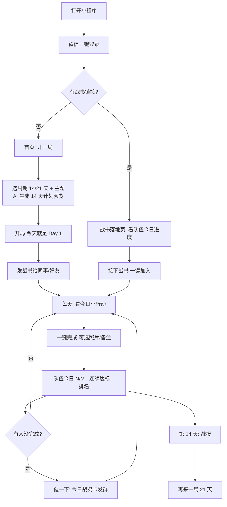

# FitSquad 瘦身战队 · MVP 产品需求文档（PRD v1.0 · 已冻结）

> 版本：v1.0（开发基线，2026-10-25 冻结）｜ v0.9 日期：2026-10-24 ｜ 主体：个体工商户 ｜ 平台：微信小程序
> v0.9 是一次重构：从“押积分的减重结算游戏”改为“熟人战队 + AI 每日小行动 + 连续达标”。v0.8 及以前的完整文档见 `.backup/v0.8-2026-10-24/docs/`。

## 0. v1.0 开工决定（优先级高于下文，冲突时以本节为准）
| # | 决定 | 影响 |
|---|---|---|
| D1 | **第一版不做用户发布内容（UGC）**：不开放拍照、不开放“说一句”。队内动态只有系统生成的打卡记录（“Mia 8:02 完成了 绕楼走 15 分钟 · 今天第一个”）和 3 个表情 | 规避个体户主体拿不到社交类目资质的风险；C-02 的拍照 / 说一句、C-06 照片相关、R-07 的照片 / 一句话后置，等类目与资质确认后再开 |
| D2 | **第一版不接大模型**：每日 9 项清单由规则引擎从人工审核的模板库挑选、排序；“推荐理由”和口语文案都由人工预先写进模板 | 省掉生成式 AI 的合规手续和不稳定环节；PRD 里“AI 推荐 / AI 排的”在第一版指规则推荐，界面文案保留“AI 推荐”。验证后再接已备案的大模型做推荐理由和文案改写（P-04 回退机制已预留） |
| D3 | **节假日日历**：维护一份 `holidays/YYYY.json`（法定假日 + 调休上班日），每年 11 月国务院公布次年安排后人工更新一次；周末默认休息日，调休上班日按工作日 | 工作日 / 休息日判断不依赖第三方接口 |
| D4 | **衬线数字字体**：使用开源可商用的思源宋体（Source Han Serif / Noto Serif SC），只子集化数字和少量常用字，`wx.loadFontFace` 从云存储加载；加载失败回退系统字体 | 无字体授权风险；子集化控制体积 |
| D5 | **订阅消息模板**：小程序认证、类目确定后，由运营在公众平台申请 3 个模板（明早提醒 / 被队友催 / 全员到齐或战报出来了）；拿不到的模板，对应能力先用分享卡片兜底 | 开发按“有模板就发、没有就降级”实现 |

## 1. 产品概述

**一句话定位**：拉上同事 / 好友 / 家人开一局 14 天挑战，AI 每天给全队一个 15 分钟内做得到的小行动，谁完成了、谁在摸鱼，全队都看得见。

**产品灵魂**：不是减肥工具，是熟人之间互相盯着的小游戏。AI 负责“今天做什么”，队友负责“你今天到底做了没”。

**设计基调**：碳白竞技：大面积白（#FAFAF8 底、#FFFFFF 卡片）+ 碳黑 #141414（主文字、主按钮、黑色头部）+ 信号橙 #FF5A1F（只用于 AI 推荐、打勾、连胜 / 关键数字、当前 tab，每屏 ≤ 2 处）；1px 细线 #EEECE7 分层，不用粗描边和硬投影；大数字用衬线体；简单、醒目、有竞技感（色值见 `mockup/SHARED-SPEC.md`）。

| 人群 | 特征 | 核心诉求 |
|---|---|---|
| 同事 / 部门 | 25–40 岁久坐职场人，一个人坚持不下去 | 有人盯着、每天有话题；也是通向企业版的场景 |
| 好友 / 饭搭子 | 同学、球友、饭搭子 | 好胜心、社交乐趣、养成习惯 |
| 家人 / 亲友 | 夫妻、兄弟姐妹、闺蜜 | 一起做件事 |

**MVP 唯一核心假设**：熟人组队 + 每天一个小行动，能带来高留存和自发裂变。

**三条产品原则**：
1. **越少越好**：每一屏一个主按钮；用户每天只需要做一件事、点一下。
2. **不让人等**：开局即开始，队友随时能加入；一个人也能先开局。
3. **只比坚持，不比体重**：排名看完成率和连续达标，不看谁瘦得多；体重只是本人可选的私密记录。

**MVP 验证目标**（种子期 3–5 支队、15–25 人）：每队自发带来新成员 ≥ 1 人（K）；14 天完成率 ≥ 60%；D7 留存 ≥ 60%；一局结束后 7 天内再开一局 ≥ 50%。

## 2. 范围

**V1.0 只做**：微信登录；开一局（周期 + 主题，规则引擎生成 14 / 21 天清单，D2）；战书邀请与一键加入；每日 9 选 3 逐项打卡（按住 1 秒确认，无照片 / 备注，D1）；队伍今日进度、队伍连续达标、个人连续达标；队内完成率排名；催一下（今日战况卡）；队内动态 + 3 个表情；我的趋势（完成率格子图，可选私密体重记录）；一局结束的战报 + 再来一局；简易后台。

| 不做 / 后置 | 版本 | 原因 |
|---|---|---|
| 积分 / 活力值 / 押注 / 奖池 / 结算金额 | 后置，需单独验证 | 没有真实价值出口，却带来经济系统、结算解释、风控和合规成本；0 押注本身就能验证社交留存 |
| 减重公斤目标、起始 / 终点称重、口令照片、上秤视频、队友互审 | 后置（未来如有“减重模式”再做） | 行为挑战不需要；它们是为押注结算服务的门槛 |
| 身体档案 / BMI / 健康上下限 | 后置 | 只有体重目标才需要；可选体重记录时才收集并单独同意 |
| 手机号绑定 | 后置 | 无押注就不需要一号一账号强校验 |
| 30 / 60 天计划 | 验证后开放 | 先用 14 / 21 天验证完成率和复参 |
| 好友榜 / 全站榜 / 积分中心 | 删除 | 排名只在队内，按完成率 |
| 免断卡、盲盒、周称号、开赛前夜竞猜、预约下一期、复仇局、围观报名、单人热身 | 删除或后置 | 机制太多违背“不动脑”；队友随时加入后，围观 / 预约 / 热身已无必要 |
| AI 对话教练、饮食处方、热量计算、照片识别 | 暂不做 | 健康与内容安全风险高 |
| 企业版（公司榜、部门 PK、HR 看板） | 第二阶段 | MVP 核心假设成立且出现企业线索后启动 |

**红线（永不做）**：任何花钱下注、赢了拿现金或实物的玩法；医疗、治疗、药物、极端节食、断食、脱水相关内容；公开任何人的体重 kg 或身体照片。

## 3. 核心流程



## 4. 功能需求

### 4.1 用户
| ID | 需求 | 说明 |
|---|---|---|
| U-01 | 微信登录 | `wx.login` 拿 openid，首次进入自动建档；登录页只有“微信一键登录”+ 协议勾选（含《隐私政策》《健康免责声明》） |
| U-02 | 昵称头像 | 用微信头像昵称组件，用户可改 |
| U-03 | 可选体重记录 | 不强制。用户在“我的趋势”主动点“记一下体重”时，才填身高（首次）和体重；首次须**单独勾选**同意处理身高、体重（附《隐私政策》，不默认勾选）。体重只本人可见，不进排名、战报、海报 |
| U-04 | 健康提示 | 登录协议含《健康免责声明》；计划页常驻一行“不适即停，有基础疾病请先咨询医生”。孕期、哺乳期、有进食障碍史或基础疾病者，协议中提示先咨询医生 |
| U-05 | 注销 | 退出所有进行中的局，删除体重和照片数据 |

### 4.2 开一局
| ID | 需求 | 说明 |
|---|---|---|
| T-01 | 一屏开局 | 只选 2 项，全部有默认值：**周期**（14 天默认 / 21 天）、**主题**（综合默认 / 多走动 / 吃好点 / 早点睡）；队名默认“XX 的战队”可改。不选人数、不选押注、不选惩罚 |
| T-02 | AI 计划预览 | 选完立即生成计划并展示前 3 天预览（见 4.3），可“换一套”。确认即开局 |
| T-03 | 开局即开始 | 开局当天就是 Day 1，不等人、不需要确认、没有 48 小时截止和解散 |
| T-04 | 一个人也能开 | 1 人即可开局；队内排名和队伍连续达标从 2 人起显示 |
| T-05 | 人数 | 最多 10 人 |
| T-06 | 随时加入 | 局内任意一天都能通过战书加入，从加入当天开始记自己的天数；完成率 = 完成天数 / 加入后已过天数，迟到不吃亏 |
| T-07 | 战书 | 分享只有一个“发到微信”（小程序卡片，群或好友由微信自己选）；要发朋友圈才用海报。卡片 / 海报统一为“战书”：发起人头像 + “XX 向你下了战书” + 一句狠话（3 选 1，默认“谁先摸鱼谁请客，不服来战”）+ 周期和主题 + 已加入头像 + 今日 N/M 已完成 |
| T-08 | 每人同时 1 局 | 每人同时只能在 1 支进行中的战队；结束后才能开或加入下一局 |
| T-09 | 退出 | 随时可退出，不影响他人；退出后队伍连续达标按剩余成员计算 |
| T-10 | 再来一局 | 结束后一键复制战队成员和主题开下一局，周期默认升到 21 天，可改；全员收到新战书 |
| T-11 | 线下约定（可选） | 战队设置里可写一句线下约定（如“最后一名请全队喝无糖茶”），只展示在战报上，平台不参与、不记录执行 |

### 4.3 AI 每日计划
| ID | 需求 | 说明 |
|---|---|---|
| P-01 | 一队一套清单 | 全队共用一套每日清单（同一天同样的 9 项），方便比较和聊天；每人自己挑做哪 3 项；加入者零问答直接上手 |
| P-02 | 每天的内容 = 9 项清单任选 3 项 | AI 每天排出 **9 项**，分三组：🏃 动一动（如午饭后绕楼走 15 分钟、走满 6000 步、工位拉伸 5 分钟、走一次楼梯）/ 🥗 吃喝（如下午 3 点前喝 4 杯水、午饭先吃一盘菜、今天不喝含糖饮料）/ 🌙 作息（如睡前 3 分钟深呼吸、23:00 前放下手机）。其中标 1 项“AI 推荐”。每人按自己的情况**任选 3 项完成 = 今天达标**；不要求哪一组必做。**工作日 / 休息日两套侧重**（系统按法定节假日日历自动判断，周末和法定假日 = 休息日，调休上班日 = 工作日）：工作日侧重防久坐、午饭后走动、午休、办公室饮水、下午茶少糖、早睡；休息日侧重出门走更久（推荐项 30 分钟）、步数目标提高（6000 → 8000）、约队友或家人一起动、自己做饭少点外卖、聚餐不续摊、别熬夜补觉。节假日可加节日特别项（如春节“饭桌先吃菜”“拜年多走一段”） |
| P-03 | 标签与筛选 | 每项带分组、日期类型（工作日 / 休息日 / 通用 / 节日）、时长（≤5 / 5–15 分钟）、场景（办公室 / 家 / 户外 / 随时）、核验方式（自报 / 微信运动）、可打卡时间窗；每天 9 项里至少 4 项 ≤ 5 分钟、至少 2 项“随时可做”，保证忙的人也能达标；每 7 天一天以恢复类为主 |
| P-04 | 生成方式 | **v1.0 按 D2 用规则引擎**：按（主题、日期类型、日序号）从模板库挑 9 项，满足 P-03 的约束（≥ 4 项 ≤ 5 分钟、≥ 2 项随时可做、三组都有、14 天内同一项不超过 2 次、每 7 天一天以恢复类为主），推荐项按“当前时间可打卡 + 当天侧重”选出，推荐理由取模板预写文案。后续接大模型时：AI 只从人工审核过的**行动模板库**里按周期 + 主题挑选、排序、改写成口语文案；不自由生成新的运动或饮食方案。模板库 MVP 约 150 条（工作日约 70、休息日约 50、通用约 30；每天要排 9 项、14 天尽量不重复），按分组 / 时长 / 场景 / 强度打标签 |
| P-05 | 安全边界 | 只做轻 / 中强度；不出现热量、克数、断食、节食、药物、补剂、疾病判断、减重承诺；文案过敏感词与医疗词过滤，失败时回退到固定模板计划 |
| P-06 | 可追溯 | 计划生成后固定，记录版本；当天行动当天 00:00 解锁，不能提前打卡 |

### 4.4 每日打卡
| ID | 需求 | 说明 |
|---|---|---|
| C-01 | 逐项打卡 | 打卡页从上到下：①日期类型标签（💼 工作日 / ☀️ 休息日）+ 一句标题（“再做 1 项，今天就达标”）+ 今天状态；②**3 个贴纸槽**，做完一项贴一张，贴满变荧光绿；③**AI 推荐卡**，只推 1 项，附一句“为什么现在做”；④剩余清单按三组列出，每组标题写当天侧重点，已完成的不再重复显示；锁定项写明几点解锁，步数项用小圆环显示进度 |
| C-02 | 打卡确认 = 按住 1 秒 | 每项右侧是圆形打勾按钮；点了弹确认：“真的做完了？会发到队内动态，队友都看得到。没做完就先别按，排名只奖励真做了的人。”主按钮为**按住 1 秒确认**（按钮内有填充进度，松手即取消），次按钮“还没，等下再来”。只提醒、不惩罚。（拍照 / 说一句按 D1 后置） |
| C-03 | 今天状态 | 顶部可选：🙂 正常（默认，显示 9 项）/ ⏱ 很忙（只显示 5 分钟内的项，仍是 3 项达标）/ 🤒 不太舒服（只显示恢复类：深呼吸、喝温水、早点睡等，**做 1 项即达标**，每局最多 2 天，同屏提示持续不适请就医）。不支持补卡 |
| C-04 | 完成反馈 | 第 3 项完成（达标）时一屏反馈：个人连续达标 +1、全队今日 N/M 达标、实时排名；最后一个让全员达标的人显示“全员到齐，队伍连续达标 +1”。达标后剩下的项还能做，只计“额外完成”，不进排名 |
| C-05 | 提醒 = 微信服务通知 | 微信订阅消息是一次性授权、且必须由用户点按钮触发（长期订阅只开放给政务 / 医疗 / 交通 / 教育等行业，不适用）。做法：**点“我做完了”的同一下**，同时请求 3 个模板的授权——①明早提醒（今天的行动）②被队友催 ③全员到齐 / 战报出来了；第一次弹窗引导勾选“总是保持以上选择”，之后不再弹窗。效果：每天打卡的人每天都能收到通知。开一局、接下战书时也顺手请求一次。完全不打开小程序的人攒不到额度，只能靠微信群里的分享卡片兜底 |
| C-06 | 内容安全 | v1.0 无用户发布内容（D1），昵称头像走微信组件；后续开放照片 / 文字时，接内容安全接口，照片结算后 30 天删除 |
| C-07 | 防刷分（轻门槛） | ①步数类任务由微信运动（`wx.getWeRunData`）自动核验并自动打卡，不能手点；②带时间的项到点才能点（饭后 11:30 / 17:30 后、“不喝含糖饮料”20:00 后、早睡类次日早上确认）；③同一项每天只能打 1 次；5 分钟内连点多项时只有第一项立即计入，其余显示“稍后再打”；⑤每天最多计 3 项，多做的不刷排名；⑥“不太舒服”每局最多 2 天；④每次打卡都进队内动态，队友可回“就这？”。不设审核、不扣分 |

### 4.5 队伍与竞争
| ID | 需求 | 说明 |
|---|---|---|
| R-01 | 队伍今日进度 | 今日 N/M 已完成，头像点亮 / 置灰 |
| R-02 | 队伍连续达标 | 当天所有成员（当天之前加入的）都达标（各自完成 3 项，或“不太舒服”日完成 1 项）→ +1，任一人没达标 → 清零。战队主页和首页的主角数字 |
| R-03 | 个人连续达标 | 连续达标天数 + 最佳记录，显示在“我的” |
| R-04 | 实时排名 | 任何成员打卡立即刷新；按**达标率**排序（达标天数 / 加入后天数），并列看当前连续达标，再看本局完成项数（每天最多计 3 项）。只队内可见；首页一行“你第 N”，战队页全部，打卡达标反馈也显示 |
| R-05 | 催一下 | 对当天未完成的成员点“催 XX”：**对方有“被队友催”通知额度时，系统直接给他发微信服务通知**（“小王催你了 · 4/5 已经做完 · 今天的行动”），催的人不用分享；对方没额度时，按钮自动换成“发到微信”，生成今日战况卡（今日 N/M + 队伍连续达标 + “@大刘 就差你了”）由催的人发群或好友。每人每天最多催 3 次；同一人每天最多收到 1 条被催通知 |
| R-06 | 每天一条钩子 | 首页 / 战队主页最多显示一条：“Mia 已经完成了，你还没” / “就差你了，全队连续 6 天别断在你手里” |
| R-07 | 动态与表情 | 队内动态只有系统生成的打卡记录（谁、几点、完成了哪项、今天第几个 / 达标）；表情只有 3 个：💪 / 就这？ / 你礼貌吗。照片 / 一句话按 D1 后置 |

### 4.6 战报与再来一局
| ID | 需求 | 说明 |
|---|---|---|
| S-01 | 战报 | 最后一天 24:00 后自动生成：个人完成率、最长连续达标、队内名次、队伍完成率、队伍最长连续达标、本局称号；线下约定（如有）提醒 |
| S-02 | 本局称号 | 只在战报颁发，每人最多 1 个，只看行为：全勤王（全部达标）、最稳（最长连续达标）、早鸟（第一个完成次数最多）、压哨王（最后补齐全员次数最多）、摸鱼选手（完成率最低，温和调侃，并列时空缺） |
| S-03 | 战报海报 | 只显示百分比和天数，不显示体重；可分享到群 / 朋友圈 |
| S-04 | 再来一局 | 战报页唯一主按钮（T-10） |

### 4.7 我的趋势
- 完成率格子图：本局每天一格（绿 = 达标、浅绿 = 不太舒服日、灰 = 未达标），当前达标率、个人连续达标 / 最佳。
- 可选私密体重：每周记 1–2 次即可，折线展示，只本人可见（U-03）。
- 历史战报列表。

### 4.8 文案规范
诙谐、互相调侃、激发好胜心，像同事之间打赌。红线：
1. 只调侃行为（摸鱼、不打卡、嘴硬、熬夜），不调侃体型、体重、长相、性别、年龄、健康状况；文案不出现具体 kg。
2. 失败不羞辱：自嘲 + 约下一局。
3. 不鼓励节食、断食、催吐、脱水、过量运动；不承诺减重效果。

### 4.9 运营后台
用户查询与封禁；战队查询；行动模板库管理（增改、上下线、审核）；AI 计划抽检与回退；内容举报处理。

## 5. 风控（MVP 只保留必要项）
| 规则 | 触发 | 处理 |
|---|---|---|
| 照片重复 | 图片哈希与历史相同 | 不显示在动态，标记 |
| 内容违规 | 内容安全接口命中 / 被举报 | 隐藏 + 人工复核 |
| 异常账号 | 同设备批量账号、异常聚集 | 人工复核 |
| AI 计划异常 | 敏感词 / 医疗词命中、强度超出模板标签 | 回退固定模板计划，记录并人工抽检 |

无积分、无押注后，不再需要积分流水、奖池、新用户失败、终点审核、信用分等风控规则。

## 6. 页面清单（9 个）
| # | 页面 | 主要元素 |
|---|---|---|
| 1 | 登录 | Slogan、微信一键登录、协议 |
| 3 | 首页 | 有局：队伍连续达标（主角）+ 今日行动 + 一个“去完成”按钮 + 一条钩子；无局：开一局 / 有战书直接上车 |
| 4 | 开一局 | 周期 + 主题 + AI 计划前 3 天预览 + 开局 |
| 5 | 战书落地页 | 发起人 + 狠话 + 队伍今日进度 + 计划前 3 天 + 接下战书 |
| 7 | 战队主页 | 队伍连续达标、今日 N/M、催一下、队内排名、动态 |
| 8 | 打卡 | 今天状态（正常 / 很忙 / 不太舒服）+ 9 项清单分三组逐项打卡 + 确认提醒 → 达标反馈 |
| 9 | 战报 | 个人 / 队伍数据、称号、再来一局 |
| 13 | 我的 | 完成率格子图、连续达标、可选私密体重、历史战报、设置 |
| 14 | 分享海报 | 战书 / 战报 |

一级页 tab：今日（首页）/ 战队 / 我的。

## 7. 数据模型（云开发）
```text
users        openid, nickname, avatar, height_cm(可选), health_consent_at(可选),
             streak_days, streak_best, created_at, deleted_at
teams        name, captain_id, theme(all|walk|food|sleep), period_days(14|21),
             start_date, end_date, status(active|ended), plan_id, offline_note,
             taunt, team_streak, team_streak_best, prev_team_id
team_members team_id, user_id, joined_at, left_at, done_days, rank, title
plans        plan_id, version, theme, period_days, generated_by(ai|fallback), created_at
plan_days    plan_id, day_no, date, day_type(workday|holiday), item_ids[9], recommended_id, recommend_reason, texts[9]
actions      action_id, group(move|food|rest), day_type(workday|holiday|any|festival), recovery(是否恢复类),
             minutes, scene, intensity(light|medium),
             verify(self|werun), open_after, text, status, reviewed_by
checkins     team_id, user_id, day_no, date, action_id, mood(normal|busy|unwell),
             verified_by(self|werun), counted(是否计入排名), photo_url, photo_hash,
             note, created_at                     /* 未完成不写记录 */
interactions team_id, from_user, to_user, type(nudge|reaction), reaction(cheer|jiuzhe|limao)
weights      user_id, date, weight_kg              /* 仅本人可见，可选 */
reports      team_id, user_id, done_rate, best_streak, rank, title, created_at
```
打卡写入、连续达标、排名、战报只在云函数里计算；前端不能直接写这些字段。

## 8. 合规清单
- [ ] 个体工商户执照 → 小程序认证 → ICP 备案；类目选“工具 / 健康管理”或“体育 / 运动健身”（以后台可选为准）
- [ ] 用户协议 + 隐私政策（说明收集头像昵称、打卡照片、可选身高体重及用途、保存期限）
- [ ] 可选体重记录：首次单独勾选同意，不默认勾选
- [ ] 健康免责声明；计划页常驻“不适即停”
- [ ] 内容安全接口；照片 30 天删除
- [ ] v1.0 不接大模型（D2）；模板库全部人工审核入库。后续接入时：使用已备案模型服务，按当时规则完成相关备案 / 标识，敏感词 / 医疗词过滤，人工抽检记录
- [ ] v1.0 无 UGC（D1）；开放照片 / 文字前先确认类目资质
- [ ] 节假日日历每年更新（D3）；思源宋体按 SIL OFL 许可使用（D4）
- [ ] 文案自查：符合 4.8 红线

## 9. 核心指标
- **北极星**：周活跃战队数（本周 ≥ 2 名成员各有 ≥ 5 天达标的战队）。
- **漏斗**：战书打开 → 登录 → 加入 / 开局 → 首次完成 → D3 → D7 → 一局完成 → 7 天内再来一局。
- **关键指标**：登录到首次完成的时长中位数（目标 < 2 分钟）、14 天完成率、D7 / D14 留存、队伍全员到齐天数占比、催一下卡片分享率与打开回流率、K 因子、再来一局率、AI 计划换一套率 / 投诉率 / 回退率。
- 种子期样本小，不做 A/B，按批次对比 + 每周访谈。

## 10. 里程碑
| 周 | 交付 |
|---|---|
| W1 | 办个体户、注册小程序、开始备案；行动模板库 80 条初稿 + 人工审核 |
| W2 | 登录、开一局、AI 计划生成（模板挑选 + 文案改写 + 回退）、战书 |
| W3 | 每日打卡、完成反馈、队伍连续达标、排名、催一下、动态 |
| W4 | 战报、再来一局、我的趋势、后台；内测 + 提审 |
| W5–W8 | 种子期 3–5 支队跑 2 局（14 天 + 21 天） |
| W9 | 复盘核心假设，决定是否加 30 天、减重模式、承诺模式、企业版试点 |

## 11. 版本记录
| 版本 | 日期 | 主要变更 |
|---|---|---|
| v0.1–v0.8 | 2026-10-17 ~ 10-24 | 押积分的熟人减重挑战：积分 / 押注 / 奖池结算、身体档案、起始与终点称重、互审、各类留存机制。完整内容见 `.backup/v0.8-2026-10-24/docs/01-PRD-MVP.md` |
| v1.0 | 2026-10-25 | 冻结为开发基线：新增第 0 节 5 项开工决定（D1 不做 UGC、D2 规则引擎代替大模型、D3 节假日 JSON、D4 思源宋体子集、D5 订阅模板有则发无则降级）；C-02 / C-06 / R-07 / P-04 / 范围 / 合规相应调整 |
| v0.9 | 2026-10-24 | **重构核心循环**：熟人战队 + AI 每日小行动 + 连续达标。删除积分 / 押注 / 奖池 / 结算金额、身体档案、减重目标、起始 / 终点称重与互审、手机号、好友榜、积分中心、免断卡、盲盒、周称号、开赛前夜、预约、复仇局、围观、单人热身、30 / 60 天；开局即开始、1 人可开、队友随时加入；排名改按完成率；体重改为本人可选私密记录；AI 计划只基于审核模板库。页面 19 → 9 |
