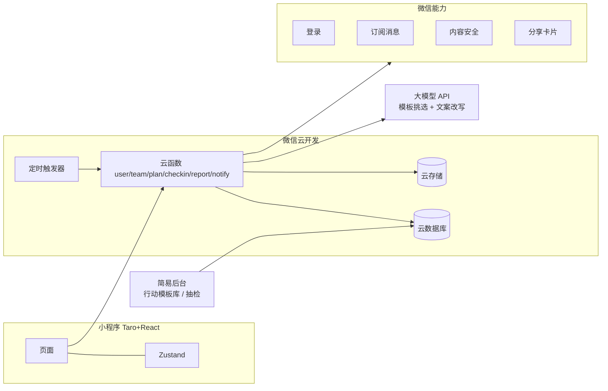

# FitSquad 瘦身战队 · 整体解决方案 v0.9

> 配套：[01-PRD-MVP.md](./01-PRD-MVP.md)（PRD v0.9）｜ [03-Mockup提示词.md](./03-Mockup提示词.md) ｜ [ops/README.md](../ops/README.md)
> v0.8 及以前（积分押注版）见 `.backup/v0.8-2026-10-24/docs/02-整体解决方案.md`。

## 1. 方案总览
| 维度 | 决策 |
|---|---|
| 形态 | 微信小程序（V2.0 再考虑抖音） |
| 主体 | 个体工商户 + 小程序认证 |
| 玩法 | 熟人 1–10 人开一局 14 / 21 天 → AI 每天给全队一张 9 项清单（动一动 / 吃喝 / 作息）→ 每人按自己情况任选 3 项完成就达标 → 看队伍连续达标、完成率排名 → 战报 → 再来一局 |
| 核心假设 | 熟人组队 + 每天一个小行动，能带来高留存和自发裂变 |
| 激励 | 不用积分。竞争来自：全队连续达标（别断在我手里）、队内完成率排名、“今天第几个完成”、本局称号、战报海报、线下自愿约定 |
| AI 的角色 | 计划供给层：从人工审核的行动模板库里挑选、排序、改写文案；不做饮食处方、热量计算、医疗判断 |
| 体重 | 本人可选的私密记录，不进排名、战报、海报 |
| 技术 | Taro + React + TS ／ 微信云开发 ／ 一个大模型 API（只做模板挑选与文案改写，失败回退固定计划） |
| 运营 | 你（CEO）+ Agent 小队（种子期 3 个）；对外内容、封号由人工把关 |
| 视觉 | 碳白竞技：大面积白（#FAFAF8 底、#FFFFFF 卡片）+ 碳黑 #141414（主文字、主按钮、黑色头部）+ 信号橙 #FF5A1F（只用于 AI 推荐、打勾、连胜 / 关键数字、当前 tab，每屏 ≤ 2 处）；1px 细线 #EEECE7 分层，不用粗描边和硬投影；大数字用衬线体；简单、醒目、有竞技感 |

**为什么 v0.9 不做积分和押注**：活力值没有任何真实出口（不能提现、不能兑换），只能在押注和结算里流转，却要用户理解冻结、奖池、部分达成、坚持奖、新用户特殊规则，还要配套口令照片、上秤视频、互审和一堆风控。它不服务“熟人组队能否留存”这个唯一假设，还让产品看起来接近下注。0 押注本身就保留了熟人较劲，等用户在没有它时也愿意每天回来，再决定是否值得做承诺模式。

## 2. 系统架构

| 层 | 选择 | 理由 |
|---|---|---|
| 前端 | Taro 4 + React + TS | 跨端，AI 写 React 最稳 |
| 后端 | 云函数 Node.js | 免运维，自带 openid 鉴权 |
| 数据库 | 云数据库 | 够用 |
| AI | 任一国内合规大模型 API | 只做“从模板里挑 + 改写口语文案”，输入输出都很短，成本低 |
| 定时 | 定时触发器 | 每日 00:00 解锁行动、计算连续达标、局结束生成战报 |
| 海报 | Canvas 2D | 前端生成 |

**AI 计划生成流程**：开局时云函数把（周期、主题）发给模型 → 模型只能从传入的模板 ID 列表里选并排序、为每条写一句口语文案 → 云函数校验（ID 合法、强度标签、每 7 天含恢复日、敏感词 / 医疗词过滤）→ 不通过就用该主题的固定计划。生成结果存为计划版本，之后不再变化。

**安全要点**：数据库仅云函数可写；连续达标、排名、战报只在云函数计算；照片私有存储 + 临时链接，30 天删除；体重只本人可读；后台管理员白名单。

## 3. 主体与资质
| 步骤 | 事项 | 耗时 | 费用（参考） |
|---|---|---|---|
| 1 | 线上办个体户执照（经营范围含“健康咨询服务（不含诊疗）”“软件开发”） | 3–7 天 | ≈0 |
| 2 | 个体户注册小程序 + 认证 | 1–5 天 | ≈300 元/年 |
| 3 | ICP 备案 | 1–3 周 | 0 |
| 4 | 开通云开发 | 当天 | 几十元/月起 |
| 5 | 用户协议、隐私政策、健康免责声明 | 1 天 | Agent 起草，人工核对 |
| 6 | 如上线 AI 生成内容，按当时规则确认是否需要算法 / 生成式服务相关备案或使用已备案模型服务 | 视情况 | — |

> 费用、类目和 AI 相关要求以办理时官方规则为准。

## 4. 增长方案
| 阶段 | 时间 | 目标 | 重点 |
|---|---|---|---|
| 种子期 | 第 1–2 月 | 50–200 人 | 3–5 支同事 / 好友队跑 2 局，验证留存 + 自发裂变 |
| 增长期 | 第 3–8 月 | 1k–10k 人 | 战书裂变 + 站外内容 + 节点挑战 |
| 变现期 | 第 9 月起 | 10k+ | 企业版、品牌赞助 |

**种子期**：你当第 1 支队队长；请 2–3 个朋友各当队长拉自己的圈子；至少 1–2 支公司队，为企业版积累案例；建种子群每周收反馈；全程拍成内容（《我拉了 4 个同事每天绕楼走 15 分钟》）。

**内置裂变（只靠这三样）**：
- **战书**：“阿杰向你下了战书 + 一句狠话”，比“邀请你加入”更像熟人打赌；局内随时能加入，点进来永远不是死路。
- **催一下 = 直接通知**：对方有通知额度时，系统直接发微信服务通知“小王催你了 · 4/5 已经做完”，催的人不用做任何事；没额度时退回“发到微信”的今日战况卡，在群里出现也是自然曝光。App 里排名本身是实时的，谁做完马上刷新。
- **提醒靠打卡续命**：点“我做完了”的同一下顺手授权明早提醒 / 被催 / 全员到齐三种通知（勾一次“总是保持”后不再弹窗），坚持打卡的人每天都能收到提醒。
- **战报海报**：“14 天全员到齐 9 天 · 小王最稳 · 大刘摸鱼选手”，失败的人也愿意自嘲转发。

**留存引擎（只靠这三样）**：
- **全队连续达标**：全员做完才 +1，一人没做就清零——“别断在我手里”是熟人产品最强的钩子。
- **每天 9 选 3，总有能做的**：至少 4 项 5 分钟以内、2 项随时可做；忙的时候只看 5 分钟的，不舒服时做 1 项恢复类也算达标——谁都没有借口断。
- **再来一局**：战报页唯一按钮，成员和主题一键复制，周期升到 21 天。

**为什么删掉其他机制**：v0.8 有十几个机制（免断卡、盲盒、周称号、开赛前夜、预约、复仇局、围观、热身……），用户根本记不住。v0.9 开局即开始、1 人可开、随时加入，围观 / 预约 / 热身自然就不需要了。

**内容渠道**：小红书每周 3–5 篇真实记录 / 办公室微运动；抖音 / 视频号每周 2–3 条“催一下”“全员到齐”现场；社群每日。

**节点**：2–3 月节后重启 ｜ 4–5 月夏天前 ｜ 9 月秋季 ｜ 11–12 月年会前。

## 5. 盈利路线
| 优先级 | 模式 | 时间 | 说明 |
|---|---|---|---|
| 1 | 企业版 | 第二阶段（核心假设成立 + 出现企业线索） | HR 采购开通、部门 PK、HR 看板（只看参与率 / 完成率，不看个人体重）、企业定制行动库、按人头年费 |
| 2 | 品牌赞助局 | V1.1+ | 运动 / 健康品牌冠名一局、线下发放奖品，平台不经手可兑换资产 |
| 3 | 会员 | V2.0 | 更多主题、更长周期、高级战报 |

海外的企业健康挑战（VantageFit、Wellable、MoveSpring、GoJoe 一类）已是成熟 B2B 付费赛道；同事组队正好是它的 C 端入口。

## 6. Agent 运营小队
| 阶段 | 启用 Agent | 触发条件 |
|---|---|---|
| 种子期 | 内容官、数据官、风控官 | 上线即用 |
| 增长期 | + 活动官、用户运营官 | 注册用户 > 1000 |
| 企业期 | + 商务官 | 出现企业线索 |

| Agent | 输出 | 频率 | 人工把关 |
|---|---|---|---|
| 内容官 | 站外增长内容、战书 / 战况卡 / 战报文案、行动模板文案初稿 | 每日 | 发布前审核；行动模板必须人工审核才能入库 |
| 数据官 | 日报、周报、流失预警名单（种子期人工按名单捞人） | 日 / 周 | 无 |
| 风控官 | 内容违规、照片重复、异常账号、AI 计划异常抽检 | 每日 | 封号由人定 |
| 活动官 | 节点挑战主题、品牌赞助局方案 | 每周 | 外发前审核 |
| 用户运营官 | 提醒文案、召回、组队撮合 | 每日 | 批量推送前确认 |
| 商务官 | 企业线索、合作方案 | 每周 | 外发前审核 |

提示词在 `ops/agents/`，日常流程见 `ops/README.md`。**安全边界**：Agent 只读脱敏数据；不改数据库、不封号；对外内容一律人工审核。

## 7. 成本（种子期每月，参考）
认证约 25 元 + 云开发 20–50 元 + 大模型调用（每局开局时调用一次，种子期几乎可忽略）+ AI 工具订阅 ≈ **300–500 元/月**。v0.9 没有积分，也就没有积分负债。

## 8. 风险与应对
| 风险 | 应对 |
|---|---|
| 没有积分，竞争不够刺激 | 全队连续达标 + 完成率排名 + “今天第几个完成” + 战报称号 + 线下约定；种子期访谈专门问“要不要加码”，有强需求再单独设计承诺模式 |
| 为了排名乱点打卡 | 每次点“做完了”弹确认提醒；步数类任务微信运动自动核验；带时间的任务到点才能点；5 分钟内连点只计第一项；每次打卡进队内动态，熟人之间的“就这？”就是最好的风控。不设审核、不扣分 |
| AI 计划不安全 / 不靠谱 | 只从人工审核模板库挑选，轻 / 中强度；敏感词 / 医疗词过滤；失败回退固定计划；后台抽检 |
| 计划太无聊 / 不适合自己 | 每天 9 项任选 3 项，按自己情况挑；模板库约 150 条，14 天尽量不重复；“换一套”；看哪些项最少被选来淘汰模板 |
| 调侃变羞辱 | 文案红线（PRD 4.8）：只调侃行为，不碰身体；体重永不公开 |
| 第 2 周流失 | 全队连续达标的压力 + 每天催一下卡片 + 轻松版兜底 |
| 一局结束就走 | 战报页唯一按钮“再来一局”，一键复制成员 |
| 隐私 | 不收身体档案；体重可选且仅本人可见；照片 30 天删除 |
| 健康事故 | 只做轻 / 中强度短时行动；登录协议 + 计划页常驻“不适即停” |
| 审核被拒 | 类目选准、协议备好、首版克制 |

## 9. 下一步
1. 你：办个体户执照、注册小程序
2. 内容官 + 你：写 80 条行动模板并人工审核
3. 一起：看 v0.9 Mockup 定交互，冻结 PRD v1.0
4. Kiro：搭 Taro + 云开发骨架，先做开一局 → 打卡 → 战队主页这条主链路
5. 你：组建第 1 支种子战队

## 版本记录
| 版本 | 日期 | 主要变更 |
|---|---|---|
| v0.1–v0.8 | 2026-10-17 ~ 10-24 | 积分押注版方案（详见备份） |
| v0.9 | 2026-10-24 | 配合 PRD v0.9 重构：玩法改为熟人战队 + AI 每日小行动 + 连续达标；删除积分 / 押注 / 结算与积分负债；架构加大模型（仅模板挑选与文案改写）和行动模板库；增长与留存各收敛为三样；风险表重写；成本降到 300–500 元/月 |
